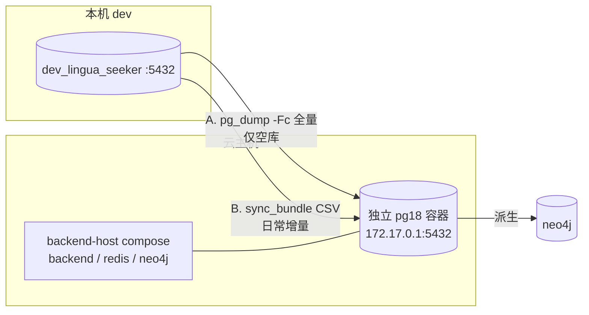

# 云上 PG 建库 / 全量引导 / 增量同步 SOP

**Status:** in-progress
**Created:** 2026-10-22
**Owner:** ops + maintainer
**Supersedes:** `2026-08-01-dev-to-prod-sync-runbook.md`（其 §3.4 假设 PG 在 `backend-host` compose 内、且 import 角色是 superuser，两点在 2026-10-16 解耦后均已失效）

---

## 0. 适用范围

云上 PostgreSQL（schema `lingua_seeker`）从空库到可用，以及此后周期性的 dev → prod 数据同步。Neo4j 是 PG 的派生数据，同步顺序固定为 **PG 完成 → Neo4j 重建**。

**不适用于**：方案/结构设计变更（走 Alembic migration），单表数据修复（走一次性 SQL）。

## 1. 拓扑与约定

| 项 | dev（唯一写入源） | prod（只读副本） |
|---|---|---|
| 主机 | 本机 | `iZj6c0l1ggld4t1dbvlxt4Z` |
| PG 位置 | 本机 127.0.0.1:5432 | **独立容器**（pg18，发布在 docker bridge 网关 `172.17.0.1:5432`，不在 `backend-host` compose 内） |
| 库 / schema / 角色 | `dev_lingua_seeker` / `lingua_seeker` / `lingua_seeker` | `lingua_seeker` / `lingua_seeker` / `lingua_seeker` |
| 角色权限 | — | **非 superuser**（`rolsuper=f`），需额外授权才能跑增量 |
| 连接参数 | `backend/config/vault/development.yaml` | `deploy/compose/backend-host/.env`（`POSTGRES_*`） |



**协议不变式**

1. dev 是唯一写入源；prod 独有行**永不删除**。
2. 增量按 UUID 主键 upsert：有 `updated_at` 的表仅在 `tgt.updated_at < EXCLUDED.updated_at` 时更新；append-only 表 `DO NOTHING`。
3. 运行时本地表不同步：`pipeline_jobs`、`pipeline_run_states`、`document_processing_cache`、`alembic_version`、`frontend_search_index`。
4. 每次 export 在 `MANIFEST.next_since` 写下次的 `--since`，**不要手工推算时间**。

## 2. 一次性前置（每个新库只做一次）

```bash
cd /opt/.../lingua_seeker
set -a; . backend-host/.env; set +a
PG=$(docker ps --format '{{.Names}}' | grep -i pg18 | head -1)
PSQL="docker exec -i -e PGPASSWORD=$POSTGRES_PASSWORD $PG psql -h 127.0.0.1 -U $POSTGRES_USER -d $POSTGRES_DB"
```

**2.1 扩展**：`vector` 必须在 `public`（Alembic 自 2026-10-16 起不再自建，缺失直接报错）。

```bash
$PSQL -c "SELECT extname, extversion FROM pg_extension;"   # 期望 vector 0.8.x
# 缺失：
# 若无 postgres 角色，换成实际 superuser（先按 §2.2 里那条 pg_roles 查询确认）
docker exec "$PG" psql -U postgres -d lingua_seeker -c "CREATE EXTENSION IF NOT EXISTS vector;"
```

**2.2 增量所需参数权限**（否则 import 卡在 `SET LOCAL session_replication_role`）：

```bash
$PSQL -c "SELECT rolname, rolsuper FROM pg_roles WHERE rolsuper;"
docker exec "$PG" psql -U postgres -d lingua_seeker \
  -c "GRANT SET ON PARAMETER session_replication_role TO lingua_seeker;"
# 验证（必须成功打印 SET）
$PSQL -v ON_ERROR_STOP=1 -c "BEGIN; SET LOCAL session_replication_role = replica; ROLLBACK;"
```

## 3. 场景 A — 空库 / 重建：pg_dump 全量引导

> 判断条件：`SELECT count(*) FROM lingua_seeker.source_documents` = 0。

**为什么不用 CSV bundle 或往 CSV 里灌全量**：库 13 GB，其中 `terminology_*` 12.7 GB；CSV 导出 8.3 GB 且恢复时要重建索引，比 custom-format 慢一个量级（2026-10-22 实测：pg_dump 1.7 GB / 49 s）。

### 3.1 dev：导出

```bash
cd /data/yangzs/Projects/01_Platform/01_ACMG_Lingua
PW=$(grep -A3 'postgres:' backend/config/vault/development.yaml | grep -m1 password | sed -E 's/.*password:\s*"?([^"]*)".*/\1/')
PGPASSWORD="$PW" pg_dump -h 127.0.0.1 -U lingua_seeker -d dev_lingua_seeker \
  --format=custom --compress=zstd:3 --schema=lingua_seeker \
  --file=data/prod_bootstrap_$(date +%Y%m%d).dump
pg_restore --list data/prod_bootstrap_$(date +%Y%m%d).dump | grep -c 'TABLE DATA'
```

**dump 自带 `CREATE SCHEMA lingua_seeker`**。恢复前只 `DROP`，不要 `CREATE`。

### 3.2 传输并拷入 PG 容器

```bash
scp data/prod_bootstrap_YYYYMMDD.dump root@<SERVER>:/tmp/
docker cp /tmp/prod_bootstrap_YYYYMMDD.dump "$PG":/tmp/boot.dump
df -h /var/lib/docker | tail -1      # 需 ≥ 15 GB 余量
```

### 3.3 停后端 → 重建 schema → restore

```bash
docker compose -f backend-host/docker-compose.yml stop backend

$PSQL -v ON_ERROR_STOP=1 -c "DROP SCHEMA lingua_seeker CASCADE;"
docker exec -e PGPASSWORD="$POSTGRES_PASSWORD" "$PG" pg_restore \
  -h 127.0.0.1 -U $POSTGRES_USER -d $POSTGRES_DB \
  --single-transaction --no-privileges --no-comments /tmp/boot.dump

docker compose -f backend-host/docker-compose.yml start backend
```

- 恢复身份是 `lingua_seeker`（owner），**不需要 superuser**：pg_restore 先建表 → 灌数据 → 最后建索引/约束/触发器，外键不会在灌数据时触发。
- `--single-transaction` 与 `-j` 互斥，别同时用。
- 失败即整体回滚，可直接重跑（先 `DROP SCHEMA`）。

### 3.4 恢复后立即验

```bash
$PSQL -c "SELECT version_num FROM lingua_seeker.alembic_version;"       # 必须 1 行 = 当前 head
$PSQL -c "SELECT pg_get_userbyid(nspowner) FROM pg_namespace WHERE nspname='lingua_seeker';"  # lingua_seeker
$PSQL -c "SELECT count(*) FROM lingua_seeker.source_documents;"          # 与 dev 一致
$PSQL -c "SELECT count(*) FROM lingua_seeker.canonical_evidence_items;"
$PSQL -c "SELECT count(*) FROM lingua_seeker.terminology_entries;"
$PSQL -c "SELECT count(*) FROM lingua_seeker.frontend_search_index;"
```

owner 若不是 `lingua_seeker`，backend 会只读失败，必须
`ALTER SCHEMA lingua_seeker OWNER TO lingua_seeker;` 并对缺表 `ALTER TABLE ... OWNER TO`。

> 顺带修掉一类历史脏数据：`alembic_version` 曾出现两行同值（`source_language_20260803` ×2）。全量 restore 会用 dev 的单行覆盖。

## 4. 场景 B — 日常增量同步

### 4.1 dev：export

```bash
cd /data/yangzs/Projects/01_Platform/01_ACMG_Lingua
PW=$(grep -A3 'postgres:' backend/config/vault/development.yaml | grep -m1 password | sed -E 's/.*password:\s*"?([^"]*)".*/\1/')
PGPASSWORD="$PW" PGHOST=127.0.0.1 PGPORT=5432 PGUSER=lingua_seeker PGDATABASE=dev_lingua_seeker \
  bash scripts/sync_dev_to_prod.sh export \
    --since '<上次 MANIFEST 的 next_since>' \
    --out data/sync_bundle_<LABEL>
```

- `--since` 取值：全量引导后首跑用 `'2026-10-17 03:32:15.213925+00'`（或任何早于 dev 最后写入的时间，幂等无副作用）；之后用 `MANIFEST.next_since`。
- `<LABEL>` 带日期，例 `incr_20261022`。
- 脚本已内置 17 张表的清单、append-only 语义、`normalized_entities` 的双阶段合并（`entity_id` 主键 + partial unique index）。**不要手工 `\copy` 绕开**。

### 4.2 打包 → 传输 → 解包

```bash
tar -czf data/sync_bundle_<LABEL>.tar.gz \
  -C /data/yangzs/Projects/01_Platform/01_ACMG_Lingua data/sync_bundle_<LABEL> \
  -C /data/yangzs/Projects/01_Platform/01_ACMG_Lingua scripts/sync_dev_to_prod.sh
scp data/sync_bundle_<LABEL>.tar.gz root@<SERVER>:/tmp/

# 云上
mkdir -p /tmp/sb && tar -xzf /tmp/sync_bundle_<LABEL>.tar.gz -C /tmp/sb
```

### 4.3 prod：import

```bash
cd /opt/.../lingua_seeker
set -a; . backend-host/.env; set +a
PG=$(docker ps --format '{{.Names}}' | grep -i pg18 | head -1)
docker exec \
  -e PGHOST=$POSTGRES_HOST -e PGPORT=$POSTGRES_PORT -e PGUSER=$POSTGRES_USER \
  -e PGDATABASE=$POSTGRES_DB -e PGPASSWORD=$POSTGRES_PASSWORD \
  "$PG" bash /tmp/sb/scripts/sync_dev_to_prod.sh import --in /tmp/sb/sync_bundle_<LABEL>
```

每张表打印 `rows_written`，结尾 `Import complete.`。全程单事务，失败不留半截。

**空 bundle 冒烟**：权限刚改完时，先用一个 delta=0 的 bundle 跑一遍，验证 `session_replication_role` / 临时表 / upsert 全链路，确认 `rows_written=0` 即可放心。

## 5. 读模型重建（每次增量后必做）

import 使用 `session_replication_role=replica`，**跳过 FK 校验与用户触发器**，派生表不会自动更新。

### 5.1 `frontend_search_index`（纯 SQL）

```bash
bash scripts/sync_dev_to_prod.sh refresh-search-index | $PSQL
```

### 5.2 `literature_profiles`（需 Python，从本机走隧道）

```bash
ssh -L 15432:172.17.0.1:5432 root@<SERVER>
# 另开终端
cd /data/yangzs/Projects/01_Platform/01_ACMG_Lingua
POSTGRES_HOST=127.0.0.1 POSTGRES_PORT=15432 POSTGRES_DB=lingua_seeker \
POSTGRES_USER=lingua_seeker POSTGRES_PASSWORD='<prod>' POSTGRES_SCHEMA=lingua_seeker \
  bash -c 'cd backend && uv run python ../scripts/refresh_business_read_models.py'
```

### 5.3 Neo4j（派生自 PG，顺序必须在 PG 之后）

```bash
ssh -L 17687:127.0.0.1:7687 -L 15432:127.0.0.1:5432 root@<SERVER>
NEO4J_URI=bolt://localhost:17687 NEO4J_PASSWORD='<prod-neo4j>' \
POSTGRES_HOST=127.0.0.1 POSTGRES_PORT=15432 POSTGRES_DB=lingua_seeker \
POSTGRES_USER=lingua_seeker POSTGRES_PASSWORD='<prod>' POSTGRES_SCHEMA=lingua_seeker \
ENVIRONMENT=production bash scripts/sync_neo4j.sh
```

## 6. 验收清单（每次同步后）

| 检查 | 期望 |
|---|---|
| `alembic_version` | 1 行，等于当前 head |
| `source_documents` 计数 | ≥ 上次值（当前基线 1941） |
| `canonical_evidence_items` | ≥ 上次值（8542） |
| `frontend_search_index` | ≈ `canonical_evidence_items` |
| `literature_profiles` | ≈ `source_documents`（1477） |
| schema owner | `lingua_seeker` |
| `GET /api/v1/graphrag/graph?gene_symbol=EGFR&hops=1&mode=full&limit=10` | 200 且 `nodes` 非空 |
| 前端证据库列表 | 条数与计数一致，详情页统计非 0 |

## 7. 故障处置

| 症状 | 根因 | 处置 |
|---|---|---|
| `schema "lingua_seeker" already exists` | dump 自带 `CREATE SCHEMA`，恢复前又手工建了 | 只 `DROP SCHEMA ... CASCADE`，不建 |
| `permission denied to set parameter "session_replication_role"` | 角色非 superuser | §2.2 `GRANT SET ON PARAMETER` |
| `FATAL: role "root" does not exist` | 客户端未设 `PGUSER` | 显式 `PGUSER=lingua_seeker` |
| `database "dev_lingua_seeker" does not exist` | 在云上用了 dev 配置 | `set -a; . backend-host/.env` |
| `type "vector" does not exist` / 后端启动即崩 | 扩展只在 dev 有 | §2.1 `CREATE EXTENSION vector` |
| `duplicate key ... uq_normalized_entities_...` | 二级唯一约束 | 已在脚本内两阶段合并处理；出现即说明用了手写 COPY |
| import 成功但前端查不到新文档 | `frontend_search_index` 陈旧 | §5.1 |
| 详情页统计数字错 | `literature_profiles` 陈旧 | §5.2 |
| 图谱页空/400 | Neo4j 未重建 | §5.3 + `scripts/check_neo4j_indexes.py` |
| `pg_restore: error: unsupported version (1.16) in file header` | 客户端低于服务端 | 用与 prod 同版本（18.x）的 pg_restore |

## 8. 基线快照（2026-10-22 实测）

| 表 | dev 行数 |
|---|---:|
| terminology_entries | 4,224,483 |
| evidence_entity_bindings | 594,268 |
| run_evidence_items | 108,763 |
| canonical_evidence_items | 8,542 |
| normalized_entities | 3,520 |
| source_documents | 1,941 |
| literature_profiles | 1,477 |
| frontend_search_index | 8,542 |

dev 最新业务写入时间 `2026-08-12 01:58:07+00`；全量 dump 1.7 GB（zstd:3），dev 库总量 13 GB。
增量基线：`exported_from_since=2026-10-17 03:32:15.213925+00`，`next_since=2026-10-22 09:30:13.878737+00`（delta=0）。

## 9. 变更记录

| 日期 | 变更 | 作者 |
|---|---|---|
| 2026-10-22 | 新建 SOP；确立"空库用 pg_dump custom-format 引导 + 日常走 CSV 增量"的两段式；补非 superuser 的 `GRANT SET ON PARAMETER` 前置；记录 `CREATE SCHEMA` 重复、`alembic_version` 双行两个坑 | AI + maintainer |