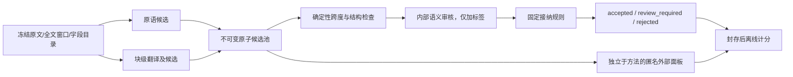

# 01 实验设计、方法单元与评价对象

**Status:** planned
**Created:** 2026-09-25
**Version:** 2.0-planning
**PR:** not created

[总计划](../2026-09-24-source-grounded-multilingual-study.md) · [数据与统计](02-data-and-analysis.md) · [实施与预算](03-execution-and-budget.md)

## 1. 研究范围与可支持的结论

任务是从原生非英语临床遗传学文献中提取可归属于原文的原子事实，并决定哪些候选技术上接纳、哪些待审或拒绝。测试的是固定系统在选定来源群体上的银标准符合度和模型判定支持度，不是临床诊断、最终 ACMG 分类或真实医生时间收益。

来源范围先沿用临床遗传学，疾病/语言/类型最终清单依资源盘点在测试前固定。已有 20 篇 Rett 领域文献承担开发任务；如果新测试仍只有该领域，标题和结论必须体现疾病范围，不能借八语言计数外推全部临床遗传学。

2026-10-15 开发阶段安排：后续 Test-v3 来源检索维持 Rett，ABC 心脏文献单列域外；正式来源名单、样本量和预算仍未冻结。BIO 当前仅准备 tmVar3 变异提及开发可行性测试，尚无完整 schema 的已验证实现，也未据此更换主要 M/B2 比较。未来子集对照的适配器、分母和主张须在正式冻结前修订。参见[决策与准入任务](../../active/2026-10-15-native-v3-bio-and-test-readiness.md)。

## 2. 研究问题与判定

| ID | 问题 | 预先指定分析 | 可得结论 |
|---|---|---|---|
| H1，主要 | 双轨是否优于等预算双次原语？ | `M−B2` 的 accepted pooled F1 差值，配对来源组区间 | 区间支持正差时，可称该预算/集合下对银标准的性能改善；实际意义还需效应阈值和成本证据 |
| H2，次要 | 语义审核对两种语言路径有何不同作用？ | `B2−F_OO_R0`、`M−F_OT_R0`，及二者差中差 | 语义审核和依赖它的接纳规则的作用；不把它写成纯粹“增加一次调用”的效果 |
| H3，次要 | 来源位置硬约束和门控改变什么？ | 固定 M 候选池的完整策略/不要求跨度/全部输出回放 | 固定候选上的选择效果，不能推出完整推理中删除模块后的效果 |
| H4，次要 | 新增候选是否受原文支持？ | 新增/丢失银标准匹配值、外部面板支持标签、成本 | 语言路径的候选互补及错误结构；不能隔离原文中的英语内容效应 |
| H5，描述 | 待审负担和资源需求如何？ | 每文献各队列数、FP、支持项/展示项、token/金额/耗时 | 技术负担代理，无实际策展计时结论 |

H1 只保留一个主要比较。不能在测试后根据哪种方法胜出而更换主要对照。最小有意义效应（SESOI）须在开发成本–效果分析后记录理由，冻结前为未定；统计显著不自动等同于有实际价值。

## 3. 事实契约

提议强类型 `AtomicEvidenceFact`，包括 `document_id/source_hash/field_id/value/polarity/scope/source_spans/evidence_role`；运行元数据与接纳决定单独建类型。该名称为拟实现接口，当前仓库尚无此 v3 接口。

- `value` 是单个事实值；多值用事实数组，不靠分号串表达集合。
- `scope` 区分文档背景、队列、病例、家族、实验对象；用来源锚点描述身份，不以 gold 病例 ID 作为输入。
- 同一病例多个表型、不同病例同一变异都可以是不同事实。仅对相同事实去重，不能每字段只保留最高分。
- `polarity` 区分阳性和明确否定。`not_reported/uncertain` 是状态，不是正向事实；禁止自动生成 `found=unknown_not_reported`。
- `evidence_role` 至少区分原文明示、确定性规范化、外部映射/推断。主评分只纳入前两者；外部派生值另列，不能混入原文事实。
- 作者宣称 pathogenic/causative 不等于本研究独立认定致病。原文 HPO 编码与从表型推导 HPO 必须区分。
- `source_spans` 可为多段，记录 UTF-8 输入上的字符索引、原始引句及来源块；规范化定位必须保留到原输入的偏移映射。

现有 143 个目录字段逐项核查为 `source_explicit / derived_only / not_applicable` 并写明依据。实际主字段清单在开发期一次定稿，所有方法与参考共用。不得因为某字段性能差而测试后排除；143→新范围的映射和理由全文披露。

## 4. 统一流程与信息边界

为隔离审核作用，核心实验的 reviewer **只判定，不新增、删除或改写事实值**。需要纠错的内容标记为待审；未来“审核后修复”必须另设方法单元。这是新实验约束，不是对旧产品行为的描述。

生成后的同一候选池供审核 on/off 和门控回放使用。内部审核可调用冻结 reasoning 模型；外部评分面板独立于方法流程，不能将其支持标签回馈给 gate。独立调用不等于模型误差独立，模型家族和角色仍须公开。

默认无目标基因/变异答案输入。若任务改为用户提供 target，必须在全部方法、参考和 manifest 中一致记录其来源，并另立任务版本。旧 gold allocation worksheet、允许候选 keys、expected 值及匹配结果对被测系统不可见。

## 5. 8 个方法单元

“单次提取”指每个完整窗口×字段批次一次提议，不是把超长全文硬塞进一次 API 调用。所有方法均可见同一原文全文，B0 的低成本不靠丢弃中间页面实现。

| ID | 提议路径 | 内部语义审核 | 输出策略 | 作用 |
|---|---|---|---|---|
| B0 | 原语一轮 | 无 | 合法非空事实候选，保留无效来源记录供计分 | 简单 prompting 参照，不称为预算匹配强基线 |
| B1 | 原语一轮，完整窗口与统一归并 | 有 | 完整接纳策略 | 原语结构化提取+审核强基线 |
| B2 | 原语两轮、互不见对方输出 | 有 | 完整接纳策略 | H1 主对照；额外预算用于第二轮有效提取 |
| B3 | 仅译语提议，回原文核验 | 有 | 完整接纳策略 | 翻译路径对照，计入 MT 成本 |
| M | 原语一轮+译语一轮 | 有 | 完整接纳策略 | 待评双轨方法 |
| F_OO_R0 | 与 B2 同一原语双轮候选池 | 无 | 结构/位置规则通过的事实；语义状态仍记未评 | 2×2 的 OO/无审核单元，仅离线评价输出 |
| F_OT_R0 | 与 M 同一双轨候选池 | 无 | 同上 | 2×2 的 OT/无审核单元，仅离线评价输出 |
| BIO | 生医工具输出+schema adapter | 有 | 完整接纳策略 | 任务适配生医基线；具体实现必须先做开发可行性核查 |

2×2 因子为提议路径 `{OO, OT}` × `{review off, review on}`。off 单元绕过语义审核及其接纳条件，不能把缺失的支持判断填成 supported；外部面板对四单元同样评价。两个 off 单元复用候选而不额外推理，是嵌套的计算实验单元，不是新的独立样本。

BIO 候选可使用 PubTator 3.0 等生医实体工具，加上固定 schema adapter。必须先核对原始接口、语言、版本、输出空间及许可；若只支持英语，使用同一 MT 并计入费用。不能直接用 NER/检索结果与完整事实 schema 比较。若没有可行 BIO 实现，协议冻结前公开删改并缩小比较主张，不能在结果出来后选择省略弱/强对手。

## 6. 同模型、输入、信息和预算的公平性

| 控制项 | 具体要求 |
|---|---|
| 模型 | 比较方法的 proposer、reviewer、relevance scan 各角色固定同一配置；BIO 工具的额外模型明确列出 |
| 数据 | 同一全文、解析版本、字段目录、外部 target 信息；只改变预定路径 |
| 提取提示 | OO 两轮使用相同任务规范、独立请求，无互相结果；OT 的语义规范相同，输入语言不同 |
| 翻译 | 固定模型、块 ID、提示与版本；每个重复运行重新产生该重复的译文，重复内共享以控制译文差异 |
| 检索/相关性 | 主实验关闭文献级 LLM relevance skip，全部冻结来源均进入提取；未来 relevance scan 另评 |
| 输入覆盖 | 核心方法每一正文块都进入至少一轮相应路径；因预算未处理完记 partial，不静默视为完成 |
| 预算 | M/B2 同一文献总金额或计价归一化预算上限，覆盖提议、MT、审核和重试；保留各子预算 |
| 费用利用 | B2 可在开发期增加第二轮输出额度或预定候选覆盖，但仍为两轮且参数统一，不做无效调用凑成本 |
| 预算耗尽 | 固定路由和遍历顺序，保留已完成有效事实；未处理部分产生漏检，不作结果导向补跑 |

相同额度不保证实际花费相同。主比较只能写“相同预算上限”；若要写“同实际成本”，须报告开发期选定预算点的成本–效果曲线，并在实际重叠成本区间比较。token 数跨模型/语言并不等价于金额。确认性测试默认只选一个主预算点，其他预算点是开发分析或另行预注册次要实验。

## 7. 接纳与门控回放

完整策略：类型/值合法 + 原文可定位 + 内部 reviewer 判 supported + 该字段所需身份关联充分 + 无未解决冲突。未报告独立计为字段状态；明确失败拒绝；证据不足待审。技术 accepted 不代表临床接受。

固定 M 候选和审核标签后，做三种策略：

| Policy | 操作 | 性质 |
|---|---|---|
| P_FULL | 完整规则，与 M 相同 | 一致性检查 |
| P_NO_SPAN | 仅取消位置通过要求，其余规则/标签不变 | 位置硬约束的离线选择效应 |
| P_ALL | 输出全部合法原子事实候选，忽略接纳条件 | 门控前后覆盖和错误变化 |

审核曾看到位置信息时，P_NO_SPAN 不能代表“整个系统从未使用位置核验”。不把回放结果作为该模块完整因果消融。若该主张成为论文核心，需另冻结真正屏蔽位置特征并重新审核的 live 单元。

曲线不用外部评测标签排序。预先定义内部审核置信分数或三级状态排序，冻结并保留同分处理规则（稳定 fact hash）。若内部不存在可解释的连续分数，报告三个策略点和候选/accepted 覆盖，不伪造连续风险曲线。无已接纳项时支持率/精确率记 NA，覆盖为 0。

## 8. 直接来源支持审计

所有方法候选按 `(source_hash, field, value, polarity, scope, cited_spans)` 合并为匿名审计并集。完全相同主张复用一次外部审计，不同引句或不同 scope 仍是不同项。审计不显示方法、内部置信度、gate 决定或参考匹配结果。

面板看到原文引句、固定段落边界上下文和完整主张，输出：`supported / contradicted / insufficient / unassessable`，另记身份错误。上下文规则在开发期固定并哈希；不能为某方法单独补上下文。这里评价“所引证据是否支持主张”，不声称核实整篇文献或真实临床事实。缺引句不让评判模型自行找一个来补救。

三模型多数规则必须至少 2 票 supported 才算模型支持；无多数保留 disagreement。主支持率的分母包括所有被审计输出，insufficient/unassessable/disagreement 不从分母剔除，另列分布。确定性可定位率单独计算，至少在 gate 前后各报一次，以防硬条件造成 accepted 中 100% 的机械结果被包装成准确性提升。

固定银标准未匹配但面板认为受引句支持的项单独报告为 `unmatched_but_panel_supported`；它可能是参考遗漏，不能直接称为幻觉。保持原 TP/FP/FN，不把这些项事后加入主参考。下一版参考扩充可以使用它们，但必须另立研究版本。

## 9. 错误分析及合成压力测试

预定义错误标签：未覆盖输入、字段未尝试、值粒度、规范化/翻译漂移、来源无法定位、引用不蕴含、病例/实体错配、否定处理、冲突未处理、参考可能缺失、技术失败。允许多标签，另定义用于互斥汇总的首个失败阶段，不能把重叠错误数强行相加。

若不能审计全部错误，按文献组和错误类型使用固定 seed 分层抽样，保留采样概率并区分抽样计数和总体估计，不能只选好解释的案例。

合成压力集用于契约/拒错行为：病例交换、原文文档交换、明确否定翻转、变异字符变化、空引句、复合值、多病例重复值、长文中段、表格跨行和 OCR 缺字。每例明确已知正确行为及为何确定；自然文本随意改字并不保证构成假命题。合成结果单列，不并入原生临床文献分数。
