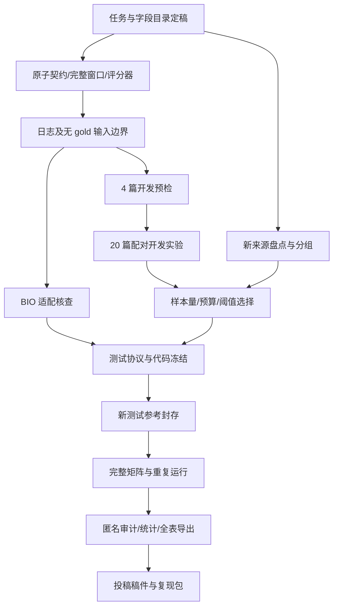

# 03 工作包、预算、排期与交付验收

**Status:** planned
**Created:** 2026-09-25
**Version:** 2.0-planning
**PR:** not created

[总计划](../2026-09-24-source-grounded-multilingual-study.md) · [方法设计](01-design.md) · [数据与统计](02-data-and-analysis.md)

本轮范围是设计与文档，不启动新模型实验。用户已确认预算、投稿时间及新文献资源未定。以下排期是工作依赖和初始估计，不是已承诺的完成日期；人员角色也尚未分配。

## 1. 执行路线与关键路径



关键路径为数据契约→可追溯实现→开发配对结果→样本量和预算→新测试来源/参考→正式比较。若新来源未获得或预算未冻结，可以继续完成工程和开发分析，不能将旧 20 篇重新命名为 test。

## 2. 代码工作范围（拟实施，尚未创建）

| 位置 | 拟负责内容 | 边界 |
|---|---|---|
| 后端 `src/core/evidence_extraction/` | 原子契约、多值归并、未报告状态、完整窗口、内部审核标签和接纳规则 | 开始实施前用 CodeGraph/实际源码核对现状；不修改旧源码归档 |
| 论文 `src/npj_native/` 的版本化扩展，或相邻 v3 feature 包 | 实验 manifest、调度、参考、匿名审计、匹配和统计 | v2 导入/默认行为保持可复算；避免复用全局 mutable study 状态 |
| 后端 `tests/`、论文 `tests/native_validation_v3/` | 业务契约回归、端到端模拟 I/O、评分与泄漏边界 | 路径为拟定，新业务代码测试不落在业务目录 |
| 论文 `scripts/` | 仅提供 prepare/reference/run/audit/analyze 阶段入口 | 命令名称在实现后确定，本文不提供伪装成可用的运行命令 |
| `docs/` | 目录定义、协议、实现指南、审查与实验结论 | 未执行计划保持 planned；完成节点归档并索引 |
| `npj_paper/data/native_validation/<new-study-id>/` | 不可变来源、请求/响应、参考、运行与派生产物 | new-study-id 在冻结时确定；不得覆盖 v2 |

Python 依赖只通过 uv 并锁版本，日志用 Loguru 写 `logs/`。新模块使用具名 Pydantic/dataclass 契约，I/O 与计分纯逻辑分离。业务模型按场景从后端统一配置读取；模板不含凭证。当前 `numpy/scipy/loguru/pytest` 已有锁定依赖，只有确需新增时才修改依赖文件。

实施属于中大型任务，届时建立独立 worktree。不得覆盖已有 dirty/staged 内容或清理 numeric-refresh。合并前需要项目规定的人工代码审查；这一代码审查与缺少临床人工标注是不同事项。

## 3. 工作包与责任角色

详表可导入任务管理器：[work-packages.csv](work-packages.csv)。责任角色不是已承诺人员。

| 包 | 任务 | 前置 | 主要输出 | 验收 |
|---|---|---|---|---|
| WP00 | 确定协议版本和决策账本 | 无 | scope/decision ledger | 未定资源明确为 null，无伪预注册声明 |
| WP01 | 审核 143 字段与原子粒度 | WP00 | catalog_v3 + v2 映射 | 每字段有来源/作用域/值规则，不按表现筛字段 |
| WP02 | 实现原子契约和三队列 | WP01 | typed contracts + normalization | 未报告不成为正向事实，多病例/多值保留 |
| WP03 | 完整窗口与译文块映射 | WP02 | coverage ledger + block mapping | 正文无静默缺口，偏移可回原文 |
| WP04 | 新参考/匿名对齐/计分器 | WP01,02 | evaluator version + tests | 同分母、跨侧编号、最大匹配、零分母规则正确 |
| WP05 | gold 访问隔离与 gate 输入审计 | WP02,04 | allowlist + access receipt | 改动无关 gold 文件不会改变产品输入/决策；系统代码不导入评分器 |
| WP06 | 重建 Dev-v3 参考 | WP01,03,04 | 20 篇新 schema 银标准 | 全部调用可追溯，v2 不变；付费前有开发预算 |
| WP07 | 方法矩阵和审核 on/off | WP02,03,05 | arms + shared immutable candidate pools | off 单元不填假支持标签；内部审核不改事实值 |
| WP08 | 调度/收据/预算/恢复 | WP07 | runner + append-only receipts | 哈希漂移拒绝、早期有效票复用、预算耗尽可见 |
| WP09 | 4 篇开发预检 | WP06,08 | preflight report | 覆盖难例和成本计量通过，不能据得分挑样本 |
| WP10 | 20 篇开发配对比较 | WP09 | M/B2 全配对结果及开发消融 | 统计/价格/参考边界明确，全部失败保留 |
| WP11 | BIO 可行性与适配 | WP07 | versioned BIO adapter 或不可行报告 | 语言、许可、输出范围和成本明确 |
| WP12 | 新来源资源盘点/分组 | WP00 | procurement manifest + exposure ledger | 与已暴露材料无已知组交叉，稀疏层明确 |
| WP13 | 功效/精度/样本量方案 | WP10,12 | simulation assumptions + N/cost curves | 使用配对组数据，报告 Monte Carlo 区间而非伪精确 N |
| WP14 | 模型/阈值/资源预算定稿 | WP10,11,13 | filled freeze manifest | 无执行必需 null，SESOI/重复数/上限有依据 |
| WP15 | 冻结正式协议和测试来源 | WP04,05,11,12,13,14 | signed hashes + exact run DAG | 主要比较未被更换，变更有 amendment |
| WP16 | 正式测试参考封存 | WP15 | reference seal + failure ledger | 封存先于被测推理，无产品输出进入参考构建 |
| WP17 | 正式方法矩阵和重复 | WP16 | all method outputs + cost receipts | 运行完整度、缓存/重复与名义方法数一致 |
| WP18 | 外部匿名来源审计/对齐 | WP17 | support ballots + alignment | 无方法/内部判定泄漏，未决和失败可见 |
| WP19 | 独立复算及全表图导出 | WP18 | analysis JSON/CSV/tables/figures | 逐组守恒，独立匹配核对，单一 manifest 生成所有主表 |
| WP20 | 写作、审稿意见闭环 | WP19 | manuscript + response matrix | 每项结论有对应证据，无模型银标准冒充人工验证 |
| WP21 | 人工审阅交付与归档 | WP20 | module guides + delivery receipt | 不擅自提交会议/期刊；保留索引/日志/源码快照 |

2026-10-09 验收口径更新（依据后续会话冻结的范围）：WP06 的工程规则与四篇开发参考离线迁移已通过[独立验收](../../archive/papers/2026-09-27-plan-progress-audit/recheck-20.md)，工作包状态记为 `completed-offline`。上表原始的 20 篇参考交付不由此次四篇复算证明完成；四篇患者事实主体覆盖限制见报告。G1 仍需真实商业 API 预检与供应商用量、费用凭据；WP10 保持待执行。

同日商业预检后续[独立核查](../../archive/papers/2026-09-27-plan-progress-audit/recheck-21.md)：45 测试与八个商业版本组合缓存重放通过，但响应完整性、事实身份传递、真实请求响应溯源及费用分账/供应商对账仍不满足 G1。WP09 维持进行中，WP10 不启动。

2026-10-10 [修复后独立复验](../../archive/papers/2026-09-27-plan-progress-audit/recheck-22.md)：53 测试与八组合重放通过，已确认合法坐标/审核主体及终止错误拒收修复；实际旧提示仍命中缓存，响应准入与失败计量、批次/模式分账和模型费率仍待闭环。3,096 条为两轮商业用量累计，本轮新增成功 1,181 条；不能据累计费用或零费用重放提升 G1/WP10 状态。

2026-10-11 [新批次独立核查](../../archive/papers/2026-09-27-plan-progress-audit/recheck-23.md)：55 测试及八组合 1,044 次缓存重放通过，首次请求绑定、准入、缺坐标与费率修复确认；内部 JSON 重试未逐次预留/结算/留存，普通校验异常仍丢用量，本地自检被记费。现存供应商计量标准价小计 $2.02823746，缺失尝试费用未知，G1/WP10 状态不提升。

同日[第 24 次修复复验](../../archive/papers/2026-09-27-plan-progress-audit/recheck-24.md)：56 测试/定向 Ruff、八组零调用重放通过；JSON 重试删除、既有异常计量和自检副本隔离已修。正式账本与上轮逐字节相同，四条旧重试结果仍用于当前协议；审核非对象 JSON 仍丢计量。报告已知计量的 $12.078640 规划小计与 $2.02823746 刊例小计正确，但预算/CSV 仍未应用缓存折扣和历史事件纠正，网络尝试也未逐次留痕。当前产物不足以证明完整执行与结算，G1 待补证，WP10 保持待执行。

同日[第 25 次账表复算](../../archive/papers/2026-09-27-plan-progress-audit/recheck-25.md)：58 测试和全量 Ruff 通过，八组1,043次重放的实际请求全部匹配；旧缓存替换、审核非对象计量、新调用折扣和全量CSV已修。正确已知计量规划小计$12.156895、刊例小计$2.04405136；导出重复扣减缓存后，两聚合表规划费实际各$12.138247，恢复预算仍累计历史自检$0.009605。缓存同键合法追加与重启结果不一致，旧缺失尝试及网络留痕仍待补证。G1维持待验收，WP10不启动。

同日[第26次边界复验](../../archive/papers/2026-09-27-plan-progress-audit/recheck-26.md)：61测试/全量Ruff、八组1,043次零调用重放通过；当前已知计量规划$12.156895、刊例$2.04405136及两聚合表对账通过，历史自检预算与缓存一致性已修。错误文本关键词仍可将有供应商计量的商业记录归零；失败路径尝试数漏记、历史缺失计数默认填1，不能据此宣称逐次调用完全留痕。已知计量小计不含旧缺失尝试的未知消费，正式结算凭据待补，G1/WP10状态不提升。

2026-10-12 [第27次边界复验](../../archive/papers/2026-09-27-plan-progress-audit/recheck-27.md)：63测试/全量Ruff、八组1,043次零调用重放与三表逐字节复算通过；上轮模型错误文本及次数指定反例已修，已知计量规划$12.156895/刊例$2.04405136继续正确。以历史请求哈希识别本地自检仍误覆盖同请求的后续网络失败，在线保守估算$0.0048025在恢复时被归零；鉴权及外层响应解析退出仍默认记1。未知消费不能改写为确定零调用，逐次尝试事件、旧缺失用量及最终结算仍待补，G1/WP10状态不提升。

同日[第28次发送与计量边界复验](../../archive/papers/2026-09-27-plan-progress-audit/recheck-28.md)：66测试/全量Ruff、八组1,043次零调用重放与三表逐字节复算通过，第27次8个边界探针已修。当前1,554条原始计量完整，规划$12.156895/刊例$2.04405136保持正确；新受控反例显示发送前初始化失败被计为模型请求，缺失/空usage被默认零费成功缓存，非法计量结构仍丢失次数。部分及缺失计量需显式表达，不能据默认零值释放未知消费；逐次尝试与旧缺失凭据仍待补，G1/WP10状态不提升。

同日[第29次 WP10 独立核查](../../archive/papers/2026-09-27-plan-progress-audit/recheck-29.md)：20 篇×4 臂已运行，68 测试/全量 Ruff、2,496 次请求匹配零调用重放及原入口全部报告/CSV 逐字节复现通过；20 份参考和 seal 复算一致。当前批次 2,498 条完整计量（含 2 条解析错误），规划 $27.323000、刊例估算 $5.32679172 正确。off 臂实际新增 517 条商业记录且 OO 少一轮，不符合复用同池消融；参考/预测规范化不对称，491/493 患者参考主体未决；主要 pooled F1 来源组区间被宏平均推断替代，文献×方法预算与 P_FULL/P_NO_SPAN/P_ALL 回放未交付。两张成本聚合表仅计 M/B2 的 1,981 条记录。WP10 状态改记“运行完成、研究验收待纠正”（in-progress），不能继续写待执行，也不能标研究验收完成或 G2 通过。G1 发送计数及空/非法计量拒收已修，部分输出计量补零、逐次尝试及旧凭据仍待闭环；先离线纠正并复验，再用于 WP13/WP14 冻结。

2026-10-13 [第 30 次纠正复验](../../archive/papers/2026-09-27-plan-progress-audit/recheck-30.md)：68 测试/全量 Ruff、140 组输出/5,726 次请求匹配零调用重放通过；同池双轮 off、对称规范化、三个 policy、pooled 计算及缺输出计量拒收已确认。491/493 患者参考仍无主体，评分新增单例 None↔patient_1；严格主体敏感性下 M/B2 的 TP 为 71/81，而非交付的 91/96。全局 $150 不能替代同文献方法上限，零预算原入口仍生成全零正常结果；来源组映射与运行失败门禁待补。累计 7,583 条规划 $54.92833625/刊例估算 $9.03337807 可复算，当前方法与旧独立 off/重新审核费用须分账，FP 不等于幻觉。WP10 保持运行完成、研究验收待纠正，G1/G2 不升级；不据当前结果冻结 WP13/WP14。

2026-10-13 [第31次纠正复验](../../archive/papers/2026-09-27-plan-progress-audit/recheck-31.md)：69测试/全量Ruff、140组输出及5726次请求匹配零调用重放通过，主体严格匹配及全局预算阻断已修。严格TP为M71/B281，pooled差-0.00321501，给定20单文献组的CI[-0.01350168,+0.00971715]可复算。非预算致命写账异常仍被吞，逐文献预算参数仅打印，空映射仍宣称20独立组已核验；40行standalone仍含1335次历史审核（规划$7.15442625/刊例估算$0.95481119），node表现仅覆盖7066条M/B2。幻觉解释收回，FP正文数字仍待同步。WP10保持运行完成、研究验收待纠正，G1/G2不提升；先落实执行/预算门禁、分组证据与费用归属再冻结后续决策。

2026-10-14 [第32次纠正复验](../../archive/papers/2026-09-27-plan-progress-audit/recheck-32.md)：71测试/全量Ruff、140组输出和5726次请求匹配零调用重放通过，原入口交付文件与20参考/seal逐字节一致。存储异常、冷启动逐篇预算、分组准入及rett_062/063合组、历史审核分账和FP正文已修；19组主要CI为[-0.01195335,+0.01300326]。逐篇预算续跑从零恢复，受控0.020000美元上限下累计0.020500美元仍正常完成，异常分支漏记逐篇结算；当前5731事件费用38.851835/6.14245940美元仍含3750条额外审核，跳过后40组主输出不变。次要宏平均和t/Wilcoxon未保留来源组依赖。WP10运行完成、研究验收待纠正，G1/G2不提升；先离线统一预算事件、部署DAG成本和组推断，再用于WP13/WP14冻结。

2026-10-14 [第33次纠正复验](../../archive/papers/2026-09-27-plan-progress-audit/recheck-33.md)：73测试/全量Ruff、140组输出和5726次请求匹配零调用重放通过，原入口全部交付文件与20参考/seal逐字节一致。原顺序续跑预算反例与四类结算出口已修；主方法1981事件规划18.43307250美元/刊例3.39833938美元、额外审核3750事件20.41876250美元/2.74412002美元分账通过，40组主输出不变；次要19组宏平均CI[-0.01590671,+0.01881391]和组t/Wilcoxon复算一致。仍有一项P1：首轮失败、次轮成功后重启，逐哈希恢复遗漏尚未遍历的次轮费用，0.020000美元上限下新增一次mock调用，累计0.021150美元后才报超限；应在首次新调用前恢复完整范围消费。当前报告披露历史仅有150美元全局预算，联合缓存重放使用10美元上限，不追认旧5美元条件。WP10运行完成、研究验收待纠正，G1/G2不提升。

2026-10-14 [第34次纠正复验](../../archive/papers/2026-09-27-plan-progress-audit/recheck-34.md)：74测试/全量Ruff、140组输出与5726次请求匹配零调用重放、原入口五CSV/报告/分组/账本副本逐字节复现通过。第33次唯一P1关闭：首轮失败/次轮成功后先恢复完整0.011100美元，随后两次重启均在发送前阻断且零新增调用；40/40文献方法预恢复金额与当前DAG收据独立计算一致，合计38.851835美元，无重复全局扣费/缓存计数。五类跨窗口失败续跑与充足预算正对照通过，未发现新阻断项。WP10当前交付的开发比较、同池消融及离线纠正复验记为completed-offline，原成本分区和19组统计结论保持；可用于后续开发决策，WP11/WP12/WP13/WP14及G2另行完成。G1旧凭据与最终结算、银标准491/493患者身份未决等边界保留，不追认历史逐篇预算或宣称M优越。

2026-10-15 WP11/WP12 初步盘点与文档整理：两份离线报告及25行开发/候选、55行历史材料清单已[归档](../../archive/papers/2026-10-15-wp11-wp12-offline-inventory/README.md)，[后续准入任务](../../active/2026-10-15-native-v3-bio-and-test-readiness.md)保持in-progress。初步盘点完成不等于整个工作包已验收。纠正56次translate为G1四篇费用、WP10累计258次含历史探索；开发集已有西班牙语rett_035，不能以同刊同领域断定ABC同组，25行表不覆盖全部暴露史。后续检索维持Rett；Aron等待正文暴露自述；可准备tmVar3已暴露开发集小样本测试，先固定版本/资源/条款/输入，不新增付费模型调用。本轮仅整理文档与局部证据核对，原研究实现和产物保持，WP10及G1/G2状态不变。

## 4. 相对排期与阶段门

初始计划按约六周工作窗口安排，实际速度取决于工程人员、来源获取、API 配额和参考构建失败率；不以赶日期为由跳过冻结。

| 窗口 | 工作 | 阶段门 |
|---|---|---|
| 第 1 周 | WP00–05；WP12 并行 | G0：任务契约、评分和无 gold 输入边界可测试 |
| 第 2 周 | WP06–09；WP11 并行 | G1：4 篇预检没有静默截断/收据丢失，费用可测 |
| 第 3 周 | WP10–14 | G2：开发配对结果支持明确后续主张，样本量与预算可以冻结 |
| 第 4 周 | WP15–16 | G3：真正新 test 与参考封存；若来源不足，时间顺延且不重标开发数据 |
| 第 5 周 | WP17–19 | G4：完整运行、外部审计、统计与复算通过 |
| 第 6 周 | WP20–21 | G5：稿件和复现包可审阅，尚未自动投稿 |

4 篇预检仅从 Dev-v3 按 metadata 选择：最长输入、一个 OCR、一个含表格/多病例、一个短文本，重复身份去重并按固定 ID 补齐到 4 篇。它们不形成新的效果推断。选定原因和顺序写入清单。

G2 若双轨无可靠开发收益，可停止扩大双轨性能主张，改为来源控制/评测研究或公开负结果；在 test 冻结前修订协议并归档。test 结果不理想时不能同样反复换题、重划数据后继续叫确认性验证。

## 5. 工程验收用例

| 类型 | 必须覆盖的输入 | 必须观察到的行为 |
|---|---|---|
| 原子化 | 多表型、多病例同变异、分号/数组混合 | 数组契约明确；不能将部分集合重叠当完整匹配 |
| 状态语义 | 未报告、明确阴性、不确定、空引句 | 未报告不计正向 found；阴性事实保留 polarity |
| 来源/作用域 | 合法引句但错病例/错值/否定 | L 可真、S/I 可假，不能因定位成功自动接纳 |
| 全文 | 证据仅在超长文中段、窗口边界、表格跨行 | 覆盖完整或显式 partial，原文偏移可复核 |
| 重复/融合 | 同事实多轮出现、不同患者相同值 | 前者去重，后者不合并；不每字段只留一个值 |
| 标签隔离 | 改 gold 内容/文件名/病例 ID | 产品请求和决策不受影响；评测输出可变化 |
| 投票/对齐 | 越界 ID、同侧边、单票、非传递等价 | 无效票拒绝留档；相同支持阈值和一对一计分 |
| 恢复/日志 | 截断响应、429、超时、成功 schema 回退 | 最早有效观察复用，失败不覆盖，写收据失败不得报成功 |
| 预算/重复 | MT/审核超支、cache hit、相同响应复用 | 所有费用记录，重复不伪造独立调用，超额停止可见 |
| 统计 | 相同文献不同方法、重复组、空参考 | 配对来源组重采样，计数守恒，宏平均集合固定 |

使用行为验收测试，不为文档排版或简单文件复制写测试。新业务模块实现后运行对应 pytest/Ruff，生成 module-guide；最终与现有 39 项相关测试集做兼容检查，测试数量不预先声称通过。

## 6. 调用与费用模型

定义 W_i 为第 i 篇实际窗口数，K 为字段批次数。初始量级：单轮提议约 W_i×K 次，翻译约 W_i 次，参考标注约 3×W_i×K_ref 次；投票/审核/对齐还需要候选批次调用，不能把“3 模型×20 文献”当总 API 数。

应从预检收据直接测量每种节点的输入/输出 tokens 和重试率，不用旧实验的 68 次调用外推新目录+完整窗口的全部成本。记：

```text
C_call = uncached_input_tokens × p_in
       + cached_input_tokens × p_cached
       + output_tokens × p_out
       + documented_other_charges

C_standalone(method,document,repeat)
       = 该方法所需全部节点费用之和（含 MT、审核、重试）

C_actual_bill = 去重缓存后的全部真实调用费用之和

C_project = C_reference_dev + C_product_dev + C_BIO_setup
          + C_reference_test + C_product_test + C_external_audit
          + C_alignment + C_retries + C_reserved_margin
```

价格统一单位（例如每百万 tokens 的同一货币），注明供应商、价格日期和缓存规则；先换算单位再求和。usage 缺失不能填零：标 unknown，记录可用账单或估计方法，并限制“同实际成本”结论。服务额度单位与金额不能混加。

共享翻译/候选只在实际账单中计一次，在每个方法独立运行成本中均按其必需节点计入。F_R0 和 policy replay 没有新的模型调用，8 个方法行不等于 8 倍完整推理费用。

预检输出三张表：node_costs.csv（节点）、standalone_arm_costs.csv（独立方法）、actual_invoice_ledger.csv（真实账单）。报告 p50/p90、长文最大值、失败重试成本；对于小样本 p90 仅作保守规划，不称精确分位数。

## 7. 预算模板与分阶段消耗

| 资源项 | 当前值 | 冻结依据 |
|---|---|---|
| 总 API 上限与币种 | 未定 | 用户资源约束 |
| 开发参考/预检额度 | 未定 | 4 篇预检前的可控小额度与报价 |
| 正式参考、产品、外部评价分项额度 | 未定 | 预检单位成本 × N/R/窗口分布 |
| 预备额度 | 建议单列，比例待定 | 已测重试与长度尾部；不得挪用后隐瞒超支 |
| N 个独立来源组 | 未定 | WP13 的功效/精度及可行性结果 |
| 重复次数 R | 建议 3；未冻结 | 总额度与 API 稳定性目标 |
| 并发 | 建议产品 2、外部面板 3 起步；未冻结 | 各模型探针与服务速率限制 |
| 时间上限 | 未定 | 投稿目标与来源/服务可用性 |

实施入口必须先校验 manifest：如果 `execution_authorized=false`、阶段 cap 或模型/来源必需字段为 null，则只允许离线 validate/estimate，不得发请求。该标志记录当前“只设计”的任务范围；以后用户授权具体实验阶段并给出约束后更新，无须为已授权且未超额的每个调用重复确认。

预算不足时，优先保持主要对照和来源审计的完整性；可以在冻结前减少探索性预算点、重复数或缩小预声明目标群体，并如实降低主张。不得运行一半后只报告有利方法或语言，亦不得把无资金运行的任务当模型失败。

## 8. 冻结清单和运行目录

`freeze-manifest.template.json` 是文档模板，不是现在可运行的配置。正式文件必须包含：模型及返回标识校验、实际参数、MT、完整目录、split/exposure、代码提交+dirty diff、源码/锁文件哈希、主要比较、SESOI 或精度目标、R、预算、随机化表、失败规则、参考 seal 和各输出路径。

拟定研究目录：

```text
<new-study-id>/
  protocol/       # 冻结配置、哈希、amendments、数据访问边界
  sources/        # 原始 PDF、真实输入、偏移/窗口覆盖
  reference/      # 独立标注、候选、投票、seal
  runs/           # document/repeat/method/node 的请求、响应、候选与决策
  audit/          # 匿名输出并集、支持/身份标签、对齐票
  analysis/       # 固定输入摘要、逐组/文献/字段计数与统计
  exports/        # 稿件表图及机器可读 CSV
  receipts/       # 执行/价格/费用/版本/独立复算收据
```

目录中不放 API 密钥。源码快照与请求提示是不同复现材料，均需保存。总表列出每个 artifact 的来源、输入 hash 和生成阶段；无法还原真实参数时不能用应用默认值补写成已调用参数。

## 9. 投稿材料验收

- 主文：一个明确研究问题、任务与数据资格、来源/语义/归属定义、同预算比较、来源指标、成本和失败。
- 补充：所有字段/文献/语言分层、完整方法配置、提示版本、消融、参考分歧和敏感性、错误例证。
- 复现：可离线复算的已留存输出、版本化源码/依赖、manifest、哈希、失败和恢复轨迹；不能承诺模型服务未来字节级重现。
- 审稿矩阵：逐条回答四份 BIBM 意见；明确独立人工标注尚未获得，不能标为完全解决。
- 自审：创新点是哪个、证据支持到哪、结果是否来自同一版、主要对照是否公平、范围是否与标题匹配。
- 投稿准备与公开发布按选定目标的实际政策另做；本计划不代表已选择期刊、已匿名发布代码或已提交。

## 10. 设计工具与方法来源

本计划使用本地 experimental-design、statistical-power、research-paper-writing 和 doc-organize 技能辅助检查配对/分组、伪重复、功效模拟及主张–证据关系。相关工具来源为：Kassis T, Agarwal V, He Y, Patel D, Brueckner AM. *Scientific Agent Skills: A Library of Procedural Knowledge for Research Agents*. 2026. [arXiv:2609.00065](https://arxiv.org/abs/2609.00065)。标题和作者于 2026-09-25 从 arXiv 元数据核验。该引用说明设计辅助工具来源，不是系统有效性或临床证据。
