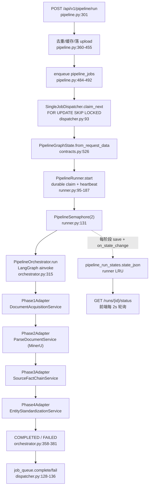
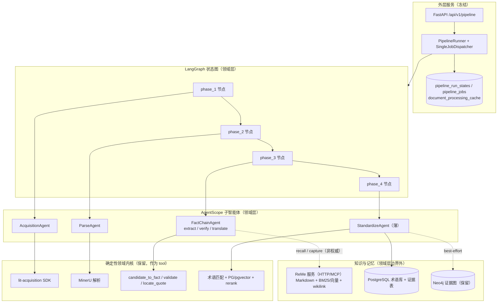

# Pipeline 技术栈替换调研与分阶段迁移方案

> LangGraph 状态图 + AgentScope 子智能体 + ReMe 知识/记忆层，仅改领域层，外层服务不动
>
> 状态：调研与方案（**未改业务代码**）
> 日期：2026-11-17
> 目标仓库：`/data/yangzs/Projects/01_Platform/01_ACMG_Lingua`
> 适用对象：pipeline 服务（`backend/src/agents/` + 其调用的 `backend/src/core/*` 领域切片 + `backend/src/api/v1/pipeline.py`）
> 结论摘要：**总体可行，但需调整 3 处定位**；需求方已确认 **ReMe 按外部知识库服务处理**；工作量 **中大型（约 9–11 人周，不含可选的 KB 整体切换；含 KB 切换 12–16 人周；含 20% 缓冲分别为 11–13 / 14–18 人周）**；有 8 个架构决策点需拍板（见 §8）。

---

## 0. 结论摘要（先看这一页）

### 0.1 一句话结论

技术栈替换**可行**，但“每个节点都变成自主 AgentScope 智能体、ReMe 全面替换现有知识库”如果按字面执行，会把临床事实的产出交给非确定性组件，削弱现有证据链的确定性与可追溯性；建议采用**“LangGraph 定拓扑 + AgentScope 有界子智能体 + ReMe 记忆/文献知识层”**的组合，其中**术语库（HGNC/ClinVar/OMIM/HPO/ClinGen）与证据图（Neo4j）继续作为权威事实存储**，ReMe 承担子智能体的记忆、召回与文献知识沉淀。

### 0.2 五个事实判断

| # | 判断 | 依据 |
|---|---|---|
| 1 | **LangGraph 已经是本仓库的编排引擎**，不是要“新引入” | `orchestrator.py:247`、`evidence_extraction/workflow.py:370`、`cross_lingual_translation/api.py:103` 共 3 个 `StateGraph`；`langgraph>=1.2.0` 已在 `backend/pyproject.toml` |
| 2 | 缺的是**拓扑显式化 + 断点/人工介入语义 + 节点级可观测**，不是图引擎本身 | 全仓库无 `checkpointer`、无 `interrupt()`、无 `Send`；崩溃恢复是“标记 FAILED 后整阶段重跑”，不是断点续跑（`state_persistence.py:560`、`contracts.py`） |
| 3 | **“自研 agent pipeline”实体上是 Phase 3 的 `source_fact_chain`（1858 行）及各阶段 adapter/服务**，AgentScope 化真正有收益的是 Phase 3 的抽取/核验/翻译推理 | `phase_3_adapter.py:37-40`、`source_fact_chain/api.py:114`；Phase 4 是确定性术语匹配（5776 行），Phase 1/2 主要是外部 SDK/HTTP 适配 |
| 4 | **ReMe 不是通用文档 RAG/图数据库**，它是“文件原生、可演化的 Agent 知识/记忆库”：Markdown + BM25/可选向量 + wikilink | ReMe 0.4.2.3 README、`reme/steps/index/search.py`（BM25+向量 RRF）、`auto_resource` 仅支持 md/txt/json/jsonl/csv/yaml/html |
| 5 | **依赖存在真实冲突**，不能“直接 `uv add` 了事” | 实测：`reme-ai[core]==0.4.2.3` 钉死 `agentscope==2.0.11`；`reme-ai` 基础包要求 `fastapi>=0.162.0`、`numpy>=2.5.4`（Py≥3.12）；`agentscope 2.0.12` 要求 `certifi>=2026.10.19`；当前锁文件是 fastapi 0.136.3 / numpy 2.3.5 / certifi 2026.5.20 |

### 0.3 建议的目标形态（与字面要求的差异）

```text
字面要求                                 建议落点
─────────────────────────────────────   ─────────────────────────────────────────
LangGraph 状态图整体编排          →      保留并显式化：4 个 phase 节点 + 每个 phase 内
                                        的 stage 子图（extract/verify/translate 等）
每个节点用 AgentScope 子智能体    →      每个 phase 一个“有界子智能体”（bounded agent）：
                                        工具=现有确定性服务，输出=现有 Pydantic 契约；
                                        推理与工具编排归 AgentScope，校验/落库仍归领域代码
知识库采用 ReMe                   →      ReMe 作为子智能体记忆 + 文献知识层（Markdown 卡片、
                                        BM25/向量召回、wikilink）；术语库与证据图保持权威
外层服务不动                      →      不新增/不修改 HTTP 契约、表结构、队列语义、状态枚举
```

### 0.4 工作量级别

| 范围 | 估算 |
|---|---|
| 核心替换（阶段 0–4：拓扑、AgentScope 运行时、四阶段 agent 化、ReMe 记忆接入） | **9–11 人周**（1–2 名熟悉该仓库的工程师；含 20% 缓冲为 11–13 人周） |
| 可选的知识库整体切换（Neo4j GraphRAG → ReMe，含数据迁移与 Phase 5 QA 改造） | 额外 **3–5 人周**，且不建议在本轮做 |
| 风险缓冲 | 上述基础上 +20%（影子运行、对照评测、回滚演练） |

### 0.5 决策点（D4 已确认，其余 7 项待拍板，详见 §8）

1. **D1 ReMe 的定位**：记忆层（推荐）还是术语/图谱知识库的整体替代（成本高、风险大）。
2. **D2 节点粒度**：4 个 phase 各一个 agent（推荐，改动可控），还是把每个 stage 都做成图节点 + agent。
3. **D3 智能体自主度**：有界工具调用 + 结构化输出（推荐），还是自由 ReAct 自主决策。
4. **D4 ReMe 部署形态**：✅ **已确认（需求方，2026-11-17）——ReMe 作为外部服务，用于知识库调用**，不计入“外层服务不动”的冻结范围。
5. **D5 版本钉法**：backend 用 AgentScope 2.0.12、ReMe 服务内用 2.0.11（推荐），还是同环境 2.0.11 + `reme-ai[core]`。
6. **D6 Phase 4 是否 agent 化**：薄封装、LLM 默认关闭（推荐），还是完全保留纯确定性服务。
7. **D7 遗留代码处置**：`evidence_extraction`（12k 行）与 `cross_lingual_translation` 保持休眠、不迁移（推荐），还是单独立项 agent 化/删除。
8. **D8 恢复与人工介入语义**：v1 保持不变（推荐），还是引入 LangGraph checkpointer + `interrupt()`（需改外层契约）。

> 以上决策不影响“先做阶段 0/1”，可以边做边定。

---

## 1. 范围、方法与判定标准

### 1.1 什么是本仓库的 “pipeline 服务”

该仓库是单体仓库（FastAPI backend + React frontend + Rust 扩展），**pipeline 不是独立部署单元**，而是 backend 内的一个垂直模块：

| 层 | 位置 | 本次是否可改 |
|---|---|---|
| 外层 HTTP/DI | `backend/src/api/v1/pipeline.py`、`api/wiring.py`、`app/main.py` | **不可改**（契约冻结） |
| 外层调度/持久化 | `backend/src/agents/{runner,dispatcher,state_persistence,processing_cache}.py`、`dao/postgresql/*`、`database/migrations/*` | **不可改**（属于外层服务） |
| **领域层（本次替换对象）** | `backend/src/agents/{orchestrator,contracts,adapters}.py` + `backend/src/core/{ingest_and_digitize_data,source_fact_chain,standardize_entities_and_align_knowledge,graph_rag}` | **可改** |
| 外部依赖 | LLM（OpenAI 兼容）、Embedding/Rerank、MinerU、lit-acquisition、Neo4j、PostgreSQL、Redis、Rust `net_io/files_io` | 接口保持不变 |
| 新增外部服务 | ReMe（知识库调用，HTTP/MCP） | 允许新增；不改动现有外层服务 |

> 说明：`src/agents/runner.py`、`dispatcher.py`、`state_persistence.py` 虽然物理上位于 `agents/`，但它们是**外层契约的实现**（队列、租约、心跳、JSONB 快照）。迁移中把它们视为“不可改”，只允许在其内部实现细节上做兼容性调整。

### 1.2 调研方法

- 静态阅读：14 个 `agents/` 文件、4 个领域切片、API 契约、DB 模型与迁移、19 个 `tests/agents` 测试文件、18 个 pipeline API 测试。
- 依赖实测：用 `uv lock` 在独立临时工程中解析 `agentscope 2.0.12` + `reme-ai 0.4.2.3` + 现有锁定版本（结果见 §4.4）。
- 上游事实核对：PyPI 元数据、AgentScope 2.0.12 文档与 wheel 源码、ReMe 0.4.2.3 README/源码，均标注版本与日期。
- 本次**不修改业务代码**；所有结论以 `path:line` 或版本事实为据。

### 1.3 判定标准

| 结论 | 含义 |
|---|---|
| **可直接替换** | 接口/语义有 1:1 对应，替换后行为可验证一致 |
| **需适配** | 能力可覆盖，但需要适配层/契约转换/新依赖 |
| **不建议替换** | 替换会引入正确性、可追溯性或运维风险，收益不足 |
| **不可行** | 存在硬阻塞（版本冲突、能力缺失、数据不可迁移） |

---

## 2. 现状（As-Is）

### 2.1 调用链：一次 pipeline run 的完整路径



关键事实：

- **状态真相源**是 `pipeline_run_states.state_json`（JSONB），每阶段入口/出口各保存一次；runner 另有 100 条 LRU 内存缓存（`runner.py:64`）。
- **没有 LangGraph checkpointer**：图在内存中 `ainvoke`，崩溃后由 `recover_orphaned_runs` 把心跳超时的 run 标为 `FAILED`（`state_persistence.py:560`），不是断点续跑。
- **重试**在 adapter 外层：`RetryablePhaseExecutor(max_retries=2, backoff_base=30s)`，仅对 `RetryablePhaseError` 重试（`concurrency.py:31-80`）。
- **阶段重跑**通过 `mode=phase + target_phase` 触发；重跑前会清理该阶段产物与派生行（`state_persistence.py:208-280`）。
- **并发**只有进程内信号量（同时 2 个 run）；阶段内部大多串行，Phase 3 的窗口循环是同步的（`source_fact_chain/runner.py:81-111`）。

### 2.2 四个阶段与领域代码的真实执行路径

#### Phase 1 — 文献/文档获取

| 项 | 内容 |
|---|---|
| Adapter | `Phase1Adapter.run`（`phase_1_adapter.py:53-156`） |
| 领域服务 | `DocumentAcquisitionService.acquire`（`ingest_and_digitize_data/document_acquisition/service.py`） |
| 真实执行 | 上传文件落盘 / 在线检索与下载委托给外部 `lit-acquisition==0.4.1` SDK（`wiring.py`），HTTP 由 Rust `net_io` 承担，失败回退 httpx |
| 输入 | `DocumentAcquisitionRequest`（source/filename/content/query/identifiers/relevance_gate/literature_types） |
| 输出 | `AcquisitionOutput(pdf_path)`；若 SDK 已预解析则写入 `state.pre_parsed_markdown` |
| 失败分类 | 无可下载 PDF → `PermanentPhaseError`；超时/限流 → `RetryablePhaseError` |
| AgentScope 化收益 | **低**：本质是外部 SDK 编排与错误分类；agent 只能包一层，LLM 不参与 |

#### Phase 2 — 文档解析

| 项 | 内容 |
|---|---|
| Adapter | `Phase2Adapter.run`（`phase_2_adapter.py`） |
| 领域服务 | `ParseDocumentService.parse_local_files_and_save` |
| 真实执行 | MinerU 远端优先、本地容器兜底（`MinerULocalParser`，`:44321`），产出 `metadata.json`（pages/content_blocks）、`md`、图片 |
| 输出 | `ParseOutput(md_path, metadata_path, output_dir, images_dir)` |
| AgentScope 化收益 | **很低**：纯外部解析服务调用，无推理 |

#### Phase 3 — 原文事实链（当前生产路径）

| 项 | 内容 |
|---|---|
| Adapter | `Phase3Adapter.run`（`phase_3_adapter.py:91-240`） |
| 领域服务 | `SourceFactChainService`（`source_fact_chain/api.py`） |
| 内部阶段 | 窗口切分（4000 字符 / 200 重叠）→ 每窗口 `extract` → 每窗口 `verify` → 仅展示字段 `translate` → 双轨投影 |
| 模型 | extract/translate 用 `cfg.llm`（fast tier），verify 用 `cfg.reasoning`（`providers.py:31-43`，符合 AGENTS §23） |
| 关键语义 | 事实 ID 只由源内容决定（document/source hash/字段/原值/极性/主体/span），与模型、提示词无关；`supported=0` → `skip_phase_4_reason=not_relevant`；复用键 = `source_hash + ChainConfig + PromptVersions` |
| 产物 | `chain_run.json`、`facts.jsonl`、`verifications.jsonl`、`english.jsonl`、`bilingual.jsonl`、`extraction_result.json`、`original.json`、`translated.json` |
| 确定性 | 强：schema 校验、原子性/极性/主体/引句定位校验都在 `core.py`，provider 只返回文本 |
| AgentScope 化收益 | **最高**：窗口级抽取、核验、翻译天然是“子智能体 + 工具 + 结构化输出”的场景 |

> 注意：仓库中另有 `evidence_extraction`（12,214 行，内部也是 LangGraph，18 个节点）与 `cross_lingual_translation`（5,328 行，内部 LangGraph）。它们在当前 pipeline 路径中**不再承担 Phase 3 生产抽取**（Phase 3 已切到 `source_fact_chain`），主要作为历史/基准/类型来源保留。迁移方案不要把这两块当作“必须 agent 化”的主体，否则工作量会翻倍。

#### Phase 4 — 实体标准化与知识对齐

| 项 | 内容 |
|---|---|
| Adapter | `Phase4Adapter.run`（`phase_4_adapter.py:54-168`） |
| 领域服务 | `EntityStandardizationService.run_dual_result` |
| 真实执行 | 读 Phase 3 的 `extraction_result.json` → 混合匹配（精确别名优先 → pgvector 语义召回 → rerank 阈值）→ 写 PG（标准实体/匹配/绑定/证据）→ 可选写 Neo4j 文献图 → ACMG 投影 |
| 术语库 | HGNC / ClinVar / OMIM / HPO / ClinGen，PG 表 + `terminology_embeddings`（`Vector(1024)`，`models.py:514-542`） |
| 输出 | `StandardizationOutput(match_count, standardized_count, ambiguous_count, unmapped_count)`；零候选 → `skip_phase_4_reason=no_candidates` |
| AgentScope 化收益 | **低–中**：核心是确定性匹配与持久化；只有“歧义消解/跨语言疾病名兜底”适合 LLM 参与 |
| ReMe 化可行性 | **不可**（术语库是有约束的结构化数据，不是 Markdown 记忆） |

### 2.3 状态机与持久化契约（外层依赖，冻结）

`PipelineGraphState`（`contracts.py:433-569`）是跨节点唯一状态，字段分五组：

| 组 | 字段 | 说明 |
|---|---|---|
| 身份 | `processing_run_id`、`source_document_id`、`owner_user_id` | UUID 字符串；owner 用于多租户 404 语义 |
| 模式 | `mode`、`source_type`、`target_phase` | FULL / PHASE；LOCAL / ONLINE |
| 去重 | `source_key`、`content_hash` | 活动 run 唯一索引 + L1/L2 缓存键 |
| 状态 | `pipeline_status`、`phase_1..4_status` | 状态转移守卫（`contracts.py:117-174`） |
| 产物 | `phase_1..4_output` | 四个强类型 Pydantic 模型 |
| 控制 | `extraction_target`、`extraction_profile`、`extraction_mode`、ablation 开关、`review_reject_policy`、`extraction_track_mode` | 直接传给领域层 |
| 其他 | `error_message/error_phase`、时间戳、`skip_phase_4_reason`、`upload_file_path`、`pre_parsed_markdown`、在线检索字段 | — |

状态转移表（合法边）：

```text
PipelineStatus: PENDING→RUNNING/FAILED; RUNNING→COMPLETED/FAILED; FAILED→PENDING; COMPLETED→PENDING
PhaseStatus:    PENDING→RUNNING/SKIPPED/FAILED; RUNNING→COMPLETED/FAILED/SKIPPED;
                COMPLETED/SKIPPED/FAILED→PENDING（阶段重跑）
```

持久化表（不可改列名/类型）：

- `pipeline_run_states(processing_run_id, source_document_id, owner_user_id, state_json, pipeline_status, last_completed_stage, source_key, owner_worker_id, heartbeat_at, ...)`，活动 run 的部分唯一索引 `(owner_user_id, source_key) WHERE status IN ('pending','running')`（`models.py:661-723`）。
- `pipeline_jobs`（队列，`FOR UPDATE SKIP LOCKED` 认领）、`document_processing_cache`（content_hash → 结果快照）。
- 领域层还会写 `source_documents` 的正文/块/语言列（渲染与证据检索读取）以及磁盘 `backend/data/pipeline/<run_id>/phase_{2,3}/...` 产物。

### 2.4 现有 LangGraph 使用情况（关键现状）

| 图 | 位置 | 节点 | 特点 |
|---|---|---|---|
| 外层 pipeline | `agents/orchestrator.py:247` | `phase_1..4` | 条件入口（PHASE 模式）、条件边、FAILED 短路；**无 checkpointer** |
| 证据抽取（历史/基准路径） | `evidence_extraction/workflow.py:370` | relevance_scan / graph_context / extraction / grounding / review / quality… | 同步 + 异步两套图；复杂 stage 逻辑在类里 |
| 翻译（历史路径） | `cross_lingual_translation/api.py:103` | format / detect / translate / skip | 简图，当前 Phase 3 不再整篇翻译 |

**结论**：LangGraph 不是缺口。真正缺口是：
1. 图的粒度太粗（4 个 phase），阶段内部仍是手写 `for` 循环/顺序调用，无法在图上观察与恢复；
2. 没有 `interrupt()`/checkpointer，人工介入只存在于 Phase 5（图外）；
3. 节点内是普通 Python 服务，没有“子智能体”抽象，模型调用、工具、记忆耦合在 provider 里。

### 2.5 知识库与检索调用点（现状）

| 调用点 | 存储 | 用途 | 当前开关 |
|---|---|---|---|
| 术语匹配 | PostgreSQL 表 + `terminology_embeddings`（pgvector 1024 维）+ 外部 rerank | Phase 4 把基因/变异/疾病/表型映射到标准术语 | 始终启用 |
| GraphRAG 上下文 | Neo4j（`:Gene/:Variant/:Disease/:Phenotype/:Evidence/:Document/:ProcessingRun`） | 证据抽取时注入子图上下文；Phase 4 写回文献图；Phase 5 QA 查询 | `graph_rag.enabled: false`（`config/defaults/main.yaml:128`），但 Phase 4 写图未受该开关约束（`standardize.../api.py:192`） |
| 处理缓存 | Redis L1 + PG L2 | 相同内容哈希直接返回历史结果 | 可配置 |
| 文献搜索/画像 | PG（`source_documents`、文献档案）+ 搜索索引 | 前端列表/检索 | 始终启用 |

**关键**：当前所谓“知识库”实际是**两套不同性质的东西**：
- **术语知识库**（强约束、精确匹配、事务写入）—— ReMe 无法替代；
- **证据图/文献记忆**（关系型知识、可检索上下文）—— ReMe 可以部分承接，但会失去 Cypher 的类型化查询与约束。

### 2.6 模型、配置与工具接入

| 类别 | 现状 |
|---|---|
| 模型配置 | 环境名实际为 `FAST_LLM_MODEL` / `REASONING_LLM_MODEL` / `TRANSLATION_LLM_MODEL`（仓库中不存在 `LLM_MODEL`/`MULTIMODAL_LLM_MODEL`）；AGENTS §23 要求按场景取用；provider 用 `create_llm_client`（OpenAI 兼容 base_url + 多 key 轮换） |
| Embedding/Rerank | 外部容器 `:8002`/`:8003`，模型 `BAAI/bge-m3` / `BAAI/bge-reranker-v2-m3`（`config/defaults/main.yaml:63-84`） |
| 文档解析 | MinerU 外部容器 `:44321` + 本地兜底 |
| 工具调用 | 无通用 tool-calling 框架；各 provider 直接构造 prompt，模型返回 JSON 后由领域代码解析/校验 |
| 结构化输出 | Pydantic `model_validate` + 自定义 schema 校验（`source_fact_chain/core.py`） |
| 重试 | 阶段级分类重试；provider 内部对超时/限流有局部重试 |

### 2.7 测试与可观测性

| 项 | 现状 |
|---|---|
| 测试 | `tests/agents/` 19 个文件、179 个用例（编排、状态转移守卫、持久化、缓存、队列、四个 adapter、Phase 5 工厂）；`tests/api/test_pipeline_api.py` 18 个用例；`tests/core/source_fact_chain/` 21 个用例；另有 `standardize` 218、`ingest` 191、`evidence_extraction` 595、`translation` 275（后两者维护休眠路径） |
| 黄金样本 | `tests/core/source_fact_chain/test_source_fact_chain.py`（21 个用例）与 `test_e2e_fabry_dual_tracks.py`（依赖 `backend/output/**/法布雷病1例`，缺失即 skip）；迁移时应把可获得的真实文档作为 parity 基线 |
| 日志 | `loguru`，阶段开始/结束/失败均有结构化日志 |
| 追踪 | `src/utils/observability.py` 有 tracing 基础；LangGraph 无节点级 trace |
| 指标 | 无指标导出；API `PhaseStatusResponse.nodes/count` 字段存在但**从未被填充**（`api/v1/contracts.py:97-121`、`pipeline.py:148-157`） |
| 前端进度 | 每 2 秒轮询相位状态；节点级进度 UI 已预留但未使用 |

### 2.8 外层边界冻结清单（摘要）

完整清单见附录 B。迁移中**必须保持**的核心项：

| # | 冻结项 | 原因 |
|---|---|---|
| 1 | HTTP 路由、请求/响应模型、状态码、`status_url` | 前端与测试直接依赖 |
| 2 | `pipeline_status` 取值 `pending/running/completed/failed`（API 另有合成值 `queued`） | DB 过滤、前端联合类型 |
| 3 | `PipelineGraphState` 现有字段名/类型（可加可选字段，不可改名/删） | API 构造、持久化、证据检索读 JSON |
| 4 | 四个 `*Output` 模型字段 | API 测试构造、证据检索读 `phase_3_output.output_dir/source_language` |
| 5 | `PhaseStatusDetail` / `PhaseErrorDetail` / 枚举值 | UI 展示、缓存、重跑 |
| 6 | `PipelineRunner` / `SingleJobDispatcher` / `JobQueueRepository` 方法签名 | `app/main.py`、路由、测试按名调用 |
| 7 | `pipeline_run_states` / `pipeline_jobs` / `document_processing_cache` 表结构与索引语义 | 队列、去重、恢复、证据检索 SQL |
| 8 | 阶段入口先写 `RUNNING` 再执行；失败/取消写 FAILED 并保留相位 | 轮询不出现 `pending→completed` 跳变；关闭不留孤儿 running |
| 9 | 重试语义（3 次、30/60s、仅 retryable）与错误对象投影 | UI 显示 attempt/max_retries；最坏时延预期 |
| 10 | 磁盘产物布局与 `phase_3` 文件集 | 重试复用、Phase 4 输入、渲染兜底 |
| 11 | 阶段重跑清理范围 | 避免残留临床行/索引 |
| 12 | owner 404 语义 | 多租户隔离 |

---

## 3. 目标架构（To-Be）

### 3.1 分层与不变量



**不变量（任何阶段都不得破坏）**

1. `pipeline_run_states.state_json` 仍是唯一运行状态真相源；不引入第二个“运行状态”数据库。
2. 临床事实（`SourceFact`/`Verification`/`EvidenceItem`/标准实体）只能由确定性代码写入；智能体只能产出候选。
3. 产物文件（`phase_3/*.json(l)`、`extraction_result.json`、`original.json`/`translated.json`）路径与结构不变。
4. 阶段失败语义、重试次数与错误对象投影不变（UI 与测试依赖）。
5. 外部 HTTP/DB/队列契约不变（附录 B）。
6. 任何新依赖的故障都不得让 pipeline 主路径失败（降级为无记忆/无上下文）。

### 3.2 LangGraph 拓扑设计

**推荐拓扑（方案 A）：4 个 phase 节点 + 只在 Phase 3 内部展开子图。**

```text
START
  └─(PHASE 模式按 target_phase 条件入口)
phase_1 ──► phase_2 ──► phase_3 ──► phase_4 ──► END
                          │
                          └─ 子图（可选，阶段 2 引入）：
                             prepare → fan-out(windows) → extract* → verify* → translate* → merge
```

- **节点状态**：继续使用 `PipelineGraphState`（Pydantic），新增字段一律可选并带默认值；`state_json` 无版本号，加载侧必须容忍缺失字段。
- **条件边**：PHASE 模式的入口选择、`skip_phase_4_reason` 短路、失败终止沿用现状（`orchestrator.py:245-285`）。
- **子图**：Phase 3 的窗口级 fan-out 用 `Send`（每个窗口一个 `extract` 任务），`facts/verifications/english` 用 `Annotated[list, operator.add]` reducer 汇总；事实 ID 已由内容决定，合并顺序不影响结果，最后统一排序落盘。
- **并发上限**：图内并发受 `asyncio.Semaphore` 约束（建议 4–8，按 provider 限流调整）；外层 `PipelineSemaphore(2)` 不变。
- **重试归属**（关键）：
  - 阶段级重试：仍由 `RetryablePhaseExecutor` 负责（3 次、30/60s，写入 `PhaseErrorDetail`）。
  - 节点内传输重试：仍由 provider 负责（Phase 3 `max_attempts=2`）。
  - **不要**再叠加 LangGraph `RetryPolicy`，否则最坏 3×2×N 次调用，UI 的 attempt 语义也会失真。
- **断点/恢复**：v1 **不引入** LangGraph checkpointer。现有契约是“崩溃→标记 FAILED→阶段重跑”，重跑复用 `chain_run.json`（source_hash+config+prompt_versions）。引入 PostgresSaver 会形成第二套恢复语义，并与 `heartbeat/owner_worker_id` 租约冲突。若未来要做“节点级续跑”，需单独立项并修改外层契约（见 D8）。
- **HITL**：v1 不做图内人工介入；Phase 5 仍是图外请求-响应服务。若未来要做，只允许一个 owner：LangGraph `interrupt()` + checkpointer，同时关闭 AgentScope 的 `ASK` 权限暂停（否则双重挂起）。
- **节点级可观测**：把每个 phase 的 `summary` 扩展为 `{"nodes": [...]}` 或填充 `PhaseStatusResponse.nodes`（API 模型已有该字段，且 `summary` 是 `extra=allow`），前端可逐步启用，不影响旧字段。

**方案 B（字面执行）：把 18+ 个 stage 全部提升为图节点。** 不推荐作为第一步，原因：
- 阶段内部存在大量共享可变状态（`ChainRun`、`StandardizationService` 的会话/事务），拆成节点后需要在图状态里序列化这些中间对象；
- Phase 4 的 6 次持久化是一个事务边界，拆节点会破坏原子性；
- 外层只认 4 个 phase 的状态与错误，节点增多不会改善用户体验，反而放大状态迁移成本。

### 3.3 AgentScope 子智能体设计

#### 3.3.1 统一节点适配器

AgentScope 2.0.12 的核心是 `Agent`（无 `__call__`），异步 `reply(inputs, structured_schema=...)` 返回 `Msg`，结构化结果在 `msg.structured_output`（dict）。因此每个图节点写成：

```python
# 领域层伪代码，非最终实现
class AgentNode:
    def __init__(self, agent_factory, schema: type[BaseModel]):
        self._factory = agent_factory
        self._schema = schema

    async def __call__(self, state: PipelineGraphState) -> PipelineGraphState:
        agent = self._factory.build(state)          # 每次调用新建，避免跨 run 污染
        payload = self._render_input(state)          # 只传必要字段，不整包序列化
        try:
            msg = await agent.reply(
                UserMsg(name="orchestrator", content=payload),
                structured_schema=self._schema,
            )
        except Exception as exc:
            raise classify_agent_error(exc)          # → Retryable/PermanentPhaseError
        output = self._schema.model_validate(msg.structured_output or {})
        return self._apply(state, output)            # 只写本阶段字段
```

要点：

- **输入渲染**：只把该节点需要的字段/文件路径传给 agent，不把整个 `PipelineGraphState` 塞进 prompt（避免泄漏、token 爆炸、隐式耦合）。
- **结构化输出**：schema 直接复用现有契约（`AcquisitionOutput`、`ParseOutput`、`TranslationExtractionOutput`、`StandardizationOutput` 或阶段内部 schema）。AgentScope 内置结构化输出工具会强制校验并在失败时回喂错误重试；但**业务校验仍必须在领域代码里再跑一遍**（见 3.3.3）。
- **工具**：把现有服务包成 AgentScope `Toolkit` 函数（docstring 自动生成 JSON schema），例如 `acquire_document(request_json) -> result_json`、`parse_pdf(path) -> paths`、`match_entities(payload) -> matches`。工具内部仍然调用原服务，**不复制业务逻辑**。
- **模型接入**：`OpenAIChatModel(credential=OpenAICredential(base_url=cfg..., api_key=...), model=cfg.llm.model, stream=False)`。现有 `LLMPoolAdapter` 有**多 key 轮换**，AgentScope credential 是单 key；需要实现一个 `RotatingCredential`/自定义 model 包装，或在每次节点调用时按轮询选择 key。这是阶段 2 必须先解决的小适配点。
- **禁用项**：v1 不使用 `GoalPipeline`/`TeamPipeline`（会形成第二套编排器），不使用 AgentScope 的 `service`/`workspace` 运行时，不使用 AgentScope 自带 RAG 知识库（知识层由 ReMe + 现有 PG/Neo4j 承担）。
- **超时/预算**：AgentScope `ReActConfig` 的迭代上限、模型层 `max_retries`、节点级 `asyncio.timeout` 三层要显式设定，且总和不得超过阶段级超时。

#### 3.3.2 每个 phase 的 agent 映射

| Phase | Agent | 工具（现有服务） | 输出 schema | 自主度 |
|---|---|---|---|---|
| 1 | `AcquisitionAgent` | `search_literature`、`download_fulltext`、`store_upload`（lit-acquisition SDK） | `AcquisitionOutput` | 低：LLM 只做检索式改写/来源选择；**默认关闭**，先 1:1 包一层 |
| 2 | `ParseAgent` | `parse_remote`、`parse_local`、`save_parse_artifacts`（MinerU） | `ParseOutput` | 极低：固定 remote→local 回退；LLM 不参与 |
| 3 | `FactChainAgent`（内含 extract/verify/translate 三个子步骤） | `extract_facts(window)`、`verify_facts(window, facts)`、`translate_presented(facts)`、`validate_candidate`、`locate_quote`、`project_dual_result` | `ChainRun` 投影 + `TranslationExtractionOutput` | 中：窗口循环与预算由 agent 编排；**校验/落盘归领域代码** |
| 4 | `StandardizeAgent`（薄） | `precise_match`、`cross_lingual_resolve`、`semantic_match`、`persist_standardization`、`project_acmg` | `StandardizationOutput` | 低：匹配仍是确定性内核；LLM 仅用于歧义解释（可选） |

> 结论：**真正值得 agent 化的是 Phase 3**；Phase 1/2/4 的 agent 主要是“统一运行时 + 可观测 + 记忆”的结构收益，不是能力收益。这一点必须在验收标准里写清楚，避免为了形式而引入 LLM 调用。

#### 3.3.3 有界智能体（bounded agent）的三个约束

1. **工具白名单**：每个 agent 只暴露本阶段工具，禁止通用 `python`/`shell`/`http` 工具（AgentScope 默认不启用，需显式不注册）。
2. **输出守门**：所有模型输出必须经过现有校验器（`validate_reply_schema`、`candidate_to_fact`、`reconcile`、`locate_quote`、`db_ready_gate`）；校验失败时 agent 可收到结构化错误并重试一次，仍失败则该窗口/阶段按现有语义失败。
3. **写权限**：agent 不直接写 PG/Neo4j/文件；写操作只通过工具函数，由工具在领域事务内完成。ReMe 写入是例外，但它是“记忆”，不参与临床事实。

### 3.4 ReMe 外部知识服务设计（已确认作为外部服务）

#### 3.4.1 部署形态

**已确认（需求方，2026-11-17）：ReMe 作为外部服务，用于知识库的调用**，不装进 backend 进程，也不计入“外层服务不动”的冻结范围。落地形态为独立进程/容器（单独 venv 或镜像），后端通过 HTTP（或 MCP）调用。

> 该确认解决的是“ReMe 能不能作为新外部服务引入”；**不改变**术语库（PG/pgvector）与证据图（Neo4j）作为权威存储的定位（见 D1）。

理由（依赖实测，见 §4.4）：`reme-ai` 要求 `fastapi>=0.162.0`、`numpy>=2.5.4`（Py≥3.12），装进 backend 会把 FastAPI 0.136.3→0.163.1、numpy 2.3.5→2.5.5、openai 2.41→3.52、langchain-core 1.4.3→1.8.1 一并升级，直接冲击“外层不动”。独立服务让 ReMe 在自己的环境里用 `reme-ai[core]`（含 agentscope 2.0.11），与 backend 的 AgentScope 2.0.12 解耦。

```text
backend (py3.12, agentscope 2.0.12, langgraph 1.2.4)
   │  HTTP/MCP: search / auto_memory / auto_resource
   ▼
reme service (独立 env/容器, reme-ai[core] 0.4.2.3, workspace 卷)
   └─ workspace/{resource,daily,digest,metadata}/
```

- 单写者：一个 workspace 只允许一个 ReMe 运行时（官方限制）；多 backend worker 只读/只发请求，不各自 `ReMe(...)`。
- 隔离：按环境一个 workspace；多用户场景不做租户隔离（ReMe 无多租户），只存“公共文献知识/运行记忆”，不存用户私有数据。
- 故障降级：检索超时（建议 300–800ms）→ 返回空记忆，节点继续；`auto_memory` 异步 best-effort，失败只告警。

#### 3.4.2 数据流

| 来源 | 写入方式 | 用途 |
|---|---|---|
| Phase 2 的 `output.md` + `metadata.json` | `auto_resource`（md/json 均支持） | 文献知识卡：标题、基因/变异/疾病、关键结论（带 `source_resource` 溯源） |
| 每次 Phase 3 的 `chain_run.json` 摘要 | 领域层生成结构化摘要 → `auto_memory`（session_id=run_id） | 运行记忆：本次抽到哪些事实、哪些被拒/未核验，供后续 run 召回 |
| 人工审核结论（Phase 5 feedback） | 领域层写卡片（frontmatter: reviewer/decision/date） | 程序性记忆：某类证据的接受/拒绝先例 |
| 现有 Neo4j 证据图 | 一次性导出脚本：节点→卡片、关系→wikilink/frontmatter | 文献知识迁移（可选，阶段 5） |

**明确不写入 ReMe 的内容**：原始事实的权威副本、术语表、逐条审计字段、任何需要事务/唯一约束的数据。

#### 3.4.3 检索与注入

- 召回时机：每个 Phase 3 agent 在 extract 前检索一次（query = 基因/变异/疾病 + 文档标题），把 top-k（≤5）卡片作为 **参考上下文** 注入 system/user prompt，并标注“仅供参考，不得作为证据来源”。
- 注入格式：`<memory source="reme" path="..." lines="...">...</memory>`；禁止把记忆内容当作 `quote`（quote 必须来自源文档，`locate_quote` 会拒绝）。
- 评测：离线构造 50–100 条“历史相似文献”查询，比较有无记忆时的抽取召回/精确率；记忆不得改变 `supported` 判定（用同一验证器）。

**与“Hermes 概念”的对应**：用户提到的 Hermes 模式可拆成两半——① 模型调用前按当前任务召回记忆并注入上下文；② 一轮任务完成后把可复用的结论异步写回记忆。本方案用 ReMe 同时承接这两半：① 即上面的 `search` → 注入；② 由节点在阶段成功后提交结构化摘要给 `auto_memory`（`session_id=run_id`，异步、失败不阻塞）。区别在于：Hermes 记忆的是“对话/任务经验”，这里记忆的是“文献知识与运行经验”，**都不进入临床事实链**。

#### 3.4.4 数据迁移（仅当 D1 选择“知识库替换”）

1. 导出 Neo4j：`MATCH (n)-[r]->(m) RETURN ...` → JSONL（节点/关系/来源文档/run）。
2. 卡片模板：一个基因/变异/疾病一个 `digest/wiki/<type>/<slug>.md`，frontmatter 保存 `source_document_id`、`processing_run_id`、`evidence_label`、`updated_at`；正文用 wikilink 表达关系。
3. 幂等写入：按 `source_document_id + fact_id` 生成稳定 slug；重复导入覆盖而非追加。
4. 校验：节点/关系计数对账；抽样 30 条做“图查询 vs ReMe 检索”结果对比；记录不可表达的关系（如带属性的边）作为已知损失。
5. 回滚：Neo4j 保留只读双写期 ≥ 2 个迭代；ReMe 故障时 Phase 5 回退图查询。

### 3.5 数据流与产物兼容

| 产物 | 生产者（迁移后） | 消费者 | 兼容要求 |
|---|---|---|---|
| `pipeline_run_states.state_json` | 外层持久化（不变） | API、证据检索、缓存 | 只加可选字段；`phase_4_status` 存在性启发式保留 |
| `data/pipeline/<run>/phase_2/*` | ParseAgent 的工具（原服务） | Phase 3、渲染 | 路径/文件名不变 |
| `phase_3/chain_run.json`、`*.jsonl`、`extraction_result.json`、`original.json`、`translated.json` | FactChainAgent 的工具（原 `write_outputs`） | Phase 4、证据检索、渲染、benchmark | 字段/行序/ID 规则不变 |
| PG 术语/匹配/证据表 | StandardizeAgent 的工具（原 repository） | Phase 4 之后、ACMG 投影、前端 | 事务边界不变 |
| Neo4j 证据图 | 工具（best-effort） | Phase 5 QA | 失败不阻塞 |
| ReMe workspace | ReMe 服务 | Agent 召回、Phase 5 QA（可选） | 可重建、可备份；不参与审计 |

---

## 4. 可行性逐项结论

### 4.1 LangGraph 能否覆盖现有语义

| 语义 | 现状 | LangGraph 1.2.x 能力 | 结论 |
|---|---|---|---|
| 顺序阶段 | 4 节点链 | `add_edge` | ✅ 已有 |
| 条件分支 | PHASE 模式入口、skip Phase 4、失败终止 | `add_conditional_edges`（返回节点名/列表/END） | ✅ 已有 |
| 循环 | 无（阶段内 `for` 循环） | 条件边回跳 + `recursion_limit` | ✅ 可覆盖；建议只用于“验证-重试”类小循环 |
| 子图 | 无（阶段内服务） | 共享 state 可直接 `add_node(compiled_subgraph)`；不同 schema 用包装节点 | ✅ 可覆盖 Phase 3 窗口子图 |
| 并发 fan-out | 无（串行窗口） | `Send` + reducer（`Annotated[list, operator.add]`） | ✅ 可覆盖；需处理顺序/去重 |
| 人工介入 | 图外（Phase 5） | `interrupt()` + `Command(resume=...)`（需 checkpointer） | ⚠️ 能力有，但 v1 不建议改契约 |
| 断点恢复 | 阶段级：`state_json` + `chain_run.json` 复用；崩溃→FAILED | `PostgresSaver`（需 `langgraph-checkpoint-postgres`，plain PG，不依赖 pgvector） | ⚠️ 能力有，但与现有租约/恢复语义冲突；v1 保持现状 |
| 节点重试 | 阶段级 executor | `RetryPolicy`（按节点） | ⚠️ 不要叠加；保持 executor 单一职责 |
| 流式/追踪 | 无 | `stream_mode`、`subgraphs=True`、`stream_writer` | ✅ 可选增强 |

**结论：LangGraph 覆盖全部所需语义，不存在“换引擎”风险。** 需要决策的只是“是否改变恢复/HITL 契约”，而不是“能否表达”。

### 4.2 AgentScope 与现有节点的对应关系

| 现有单元 | 建议 | 说明 |
|---|---|---|
| `Phase1Adapter` / `Phase2Adapter` / `Phase4Adapter` | **合并进编排器** | 只做装配/错误分类/状态写入（156/175/168 行），没有独立业务规则 |
| `DocumentAcquisitionService.acquire` | 1:1 `AcquisitionAgent` | 明确输入输出；付费墙 vs 超时的错误语义独立 |
| `lit-acquisition` SDK | **不迁**，作为外部工具/MCP | 独立库，已有配置边界与测试；重写成本高、收益低 |
| `DocumentParseOrchestrator.parse` | 1:1 `ParseAgent` | remote→local 回退是策略，适合 agent 工具编排 |
| `Phase3Adapter` | **拆分**：文本拼接/断点复用留在编排器；链执行交给 `FactChainAgent` | 适配器混了三件事 |
| `ChainRunner`（extract/verify/translate × window） | 1 个 `FactChainAgent` + 3 个 stage 工具 | 唯一真正的推理核心；预算、重试、审计必须整体迁移 |
| `EXTRACT` / `VERIFY` / `TRANSLATE` | 可拆为 3 个子步骤（同一 agent 内或 3 个节点） | verify 用 reasoning 模型，translate 只处理 2 个字段；拆分开销可控 |
| `candidate_to_fact` / `validate_reply_schema` / `reconcile` / `locate_quote` | **不建 agent**，作为强制 tool/validator | 纯函数，是输出守门器 |
| `project_dual_result` | 1:1 `ProjectionAgent`（或留在领域代码） | 381 行业务规则（gene 归属、off-target 污染），可独立测试 |
| `StandardizationService.run` | **拆分**：`MatchingAgent`（薄）+ `PersistenceTool` | 匹配有 HTTP/DB 混合依赖；持久化是事务边界，必须由工具持有 |
| `PreciseTerminologyMatcher` / `CrossLingualDiseaseResolver` | **tool** | 确定性查表/模糊匹配 |
| `SimilarityTerminologyMatcher`（embedding+pgvector+rerank） | 1:1 `SemanticMatchAgent` | 3 个外部依赖、阈值/边际策略、失败降级语义 |
| `AcmgReadyProjector` | tool 或 merge | 纯投影 |
| `evidence_extraction`（12k 行，18 节点，595 测试） | **暂不迁移**（D7） | 生产未接线；若产品需要 166 字段，整体作为 1 个 `DeepExtractionAgent`，不要拆 18 个 |
| `cross_lingual_translation`（5.3k 行，275 测试） | **不迁** | 全文翻译已被 fact-level presentation 取代；只抽 `estimate_tokens`/`detect_language` |
| `FeedbackService.patch_evidence`（Phase 5） | 可独立为 HITL agent（后续） | 唯一人工改判点，需要审计链；不属于 pipeline 图 |

**结论：AgentScope 可覆盖，但“每个节点都是 agent”应理解为“每个有独立契约的语义单元一个 agent”，而不是把纯函数也包成 agent。** 按上表，实际新增 agent 3–5 个（Acquisition/Parse/FactChain/SemanticMatch，可选 Projection），其余为工具或保留。

### 4.3 ReMe 替换现有知识库的成本与数据迁移

#### 4.3.1 能力对照

| 能力 | 现有实现 | ReMe 0.4.2.3 | 结论 |
|---|---|---|---|
| 术语精确匹配（HGNC/ClinVar/OMIM/HPO/ClinGen） | PG 表 + 别名优先级 + 唯一约束 | 无表/无唯一约束；Markdown 卡片 | ❌ 不能替代 |
| 语义检索 | pgvector 1024 维 + rerank（top_k=10、阈值 0.7、margin 0.05） | BM25 + 可选向量（faiss/zvec）+ RRF；需注入 embedding | ⚠️ 可提供近似召回，但阈值/边际/维度需重建 |
| 类型化图谱查询 | Neo4j Cypher（节点/关系/属性） | wikilink 图（frontmatter 存少量属性） | ⚠️ 只能表达“链接”，不能表达带属性关系与约束 |
| 证据溯源/审计 | PG 行 + JSONL + fact_id + span | 卡片 frontmatter + line range；无事务 | ⚠️ 不能作为权威审计源 |
| 文档接入 | MinerU→Markdown | `auto_resource` 支持 md/txt/json/jsonl/csv/yaml/html | ✅ Phase 2 产物可直接接入 |
| 跨会话记忆 | 无 | 内建（daily/digest、auto_memory/auto_dream） | ✅ 新增能力 |
| 多租户/权限 | PG + owner_user_id + 404 语义 | 无多租户，一个 workspace 一个 owner | ❌ 不能承载用户私有数据 |
| 运维 | PG 备份、Neo4j 备份 | Markdown 目录 + 可重建索引 | ✅ 简单，但需文件备份策略 |

#### 4.3.2 两种落地范围

**范围 A（推荐，与已确认的“外部知识库服务”一致）：ReMe 作为“记忆/文献知识层”，不替换权威 KB**
- 新增：ReMe 服务 + Phase 3 召回 + Phase 5 QA 的补充上下文。
- 保留：PG 术语库、Neo4j 证据图、JSONL 审计产物。
- 成本：**2–3 人周**（服务部署、卡片模板、召回评测、降级）。
- 风险：低（不改变证据路径）。

**范围 B（字面）：ReMe 替换现有知识库**
- 需要：Neo4j 全量迁移到 Markdown 卡片；Phase 4 语义匹配改为 ReMe 检索（失去精确别名优先级与唯一约束）；Phase 5 QA 改为卡片检索；补充事务/审计的替代方案。
- 成本：**3–5 人周**迁移 + **2–3 人周** Phase 4/5 改造 + 持续的对账成本。
- 风险：高（临床证据可追溯性、精确匹配回退、性能/一致性）。
- 结论：**不建议在本轮做**；若一定要做，先做范围 A，用 2 个迭代验证召回质量，再决定是否切换。

#### 4.3.3 数据迁移方式（范围 B 时）

见 §3.4.4（导出→卡片→幂等导入→对账→双写回滚）。关键难点：
- Neo4j 关系上的属性（如 `evidence_label`、`source_span`）在 wikilink 中只能放进目标卡片 frontmatter，多来源同一关系会合并/丢失；
- 同一实体多别名（HGNC symbol/previous symbol、ClinVar 别名）在 Markdown 中需要显式 alias 列表，否则检索召回下降；
- 删除/更正语义：文件系统没有事务，需“软删除 + 版本目录”。

### 4.4 依赖 / Python / uv 约束（实测）

测试方法：`uv 0.11.28` + CPython 3.12.13，临时工程，索引使用仓库同款本地镜像 `http://127.0.0.1:3141/root/pypi/+simple/`（与 `backend/pyproject.toml` 一致）。以下为真实解析结果，不是纸面推断。

#### 4.4.1 结论一：AgentScope 可以进 backend，代价很小

在**保持现有锁定版本**的前提下加入 `agentscope==2.0.12`：

```text
agentscope==2.0.12    ✅
langgraph==1.2.4      ✅ 保持不变
langchain-core==1.4.3 ✅ 保持不变
fastapi==0.136.3      ✅ 保持不变
numpy==2.3.5          ✅ 保持不变
neo4j==6.2.0          ✅ 保持不变
pydantic==2.13.4      ✅ 保持不变
openai==2.41.0        ✅ 保持不变
certifi==2026.10.23   ⬆ 从 2026.5.20 升级（agentscope 要求 >=2026.10.19）
httpx2==2.16.2        ➕ 新增
mcp==2.3.0            ➕ 新增
```

→ **backend 内进程使用 AgentScope 是低风险的**；只需 `uv lock` 更新 certifi 并接受两个新包。

#### 4.4.2 结论二：ReMe 不能进 backend（会强制升级外层栈）

`reme-ai`（无论是否 `[core]`）要求 `fastapi>=0.162.0`；实测与 `fastapi==0.136.3` 不可满足：

```text
× No solution found when resolving dependencies:
╰─▶ Because reme-ai==0.4.2.3 depends on fastapi>=0.162.0 and you require
    reme-ai==0.4.2.3, we can conclude that you require fastapi>=0.162.0.
    And because you require fastapi==0.136.3, we can conclude that your
    requirements are unsatisfiable.
```

不钉旧版本时，解析器给出的一体化升级集为：`fastapi 0.163.1`、`numpy 2.5.5`、`openai 3.52.0`、`langchain-core 1.8.1`、`pydantic 2.14.3`、`neo4j 6.4.1`、`certifi 2026.10.23`。这直接触碰“外层服务不动”，因此 **ReMe 应独立部署**。

#### 4.4.3 结论三：`reme-ai[core]` 与 AgentScope 2.0.12 互斥（同环境）

```text
× Because reme-ai[core]==0.4.2.3 depends on agentscope[model-ollama]==2.0.11
  and your project depends on agentscope==2.0.12, ... unsatisfiable.
```

原因：`reme-ai` 的 `as` extra 钉 `agentscope[...]==2.0.11`，`core` 依赖 `as`；`hermes` extra 更旧（2.0.10）。可选路径：
- **A**：backend 用 `agentscope==2.0.12`；ReMe 服务独立环境用 `reme-ai[core]`（内部 2.0.11）——推荐；
- **B**：同环境 `agentscope==2.0.11` + `reme-ai[core]`——牺牲 AgentScope 一个补丁版本，换取“单环境”；
- **C**：同环境 `agentscope[reme]==2.0.12` + 显式 `faiss-cpu`/`zvec`/`neo4j`——能装，但 `reme-ai` 仍会拉高 fastapi/numpy，等于回到结论二。

#### 4.4.4 其他版本事实

| 项 | 事实 |
|---|---|
| Python | 项目 `>=3.12`；AgentScope `>=3.11`；ReMe `>=3.11` → **无冲突** |
| LangGraph | 现锁 1.2.4；最新 1.2.22（2026-11-14）。1.2.22 要求 `langchain-core>=1.4.7`，而现锁 1.4.3 → 仅当升级 LangGraph 才需同步升级 core；**本方案不强制升级** |
| Pydantic | ReMe 要求 `>=2.13.4`；现锁 2.13.4 → 恰好满足；若整体升级会被带到 2.14.x |
| openai | ReMe 要求 `>=2.24.0`；现锁 2.41.0 → 满足；一体化升级会到 3.52（大版本，需评估） |
| uv | 本地镜像已提供 `agentscope` 与 `reme-ai`（三次解析实测均可获取）；`uv lock` 需全量重解析（实测 153–167 包） |
| 构建/部署 | backend 镜像需新增 agentscope（+httpx2/mcp）；ReMe 需新增一个服务/镜像与 workspace 卷；docker compose/K8s 变更属于运维范畴 |

### 4.5 总评

| 项 | 结论 | 说明 |
|---|---|---|
| LangGraph 状态图 | **可行（已具备）** | 3 处 StateGraph；语义覆盖完整；建议只做拓扑显式化 |
| AgentScope 子智能体 | **可行，需适配** | 2.0.12 API 稳定；需写 LangGraph 节点适配器、消息转换、key 轮换；**建议有界智能体** |
| ReMe 知识库 | **需调整** | 已确认作为外部知识库服务；可承担记忆/文献知识层；作为术语/图谱权威 KB 不可行 |
| 依赖/Python/uv | **可行，需分层** | AgentScope 进 backend 代价小；ReMe 必须独立环境 |
| 外层服务 | **可保持不变** | 所有冻结项见附录 B；前提是不引入第二套恢复/HITL 语义 |

---

## 5. 分阶段迁移方案

设计原则：**每个阶段都能独立上线、独立验证、独立回滚**；默认关闭新路径，用影子运行（shadow）对照旧路径，确认一致后再切流。任何阶段都不修改外层 HTTP/DB/队列契约。

### 阶段 0 — 基线与契约冻结（1 人周）

| 项 | 内容 |
|---|---|
| 目标 | 建立“改前基线”，让后续每个阶段都有可对照的数值与契约快照 |
| 产出 | ① 现有测试基线报告（`tests/agents` 179 + `tests/api/test_pipeline_api.py` 18 + `tests/core/source_fact_chain` 21）；② 3–5 篇代表性文档的抽取基线（facts/verifications/english 的 JSONL、耗时、token/费用、provider 调用次数）；③ 版本与依赖快照（当前 lock 的 12 个关键包）；④ 配置开关骨架 `pipeline.agent_runtime = legacy \| shadow \| agentscope`（默认 legacy）；⑤ 冻结契约清单（附录 B）评审签字 |
| 验证 | 基线测试全绿；同一文档重复运行结果稳定（事实 ID 集合一致）；基线数据存档 |
| 回滚 | 无行为变更，无需回滚 |
| 退出条件 | 基线报告 + 开关合并；团队确认“外层不改”的边界 |

> 建议同时把 `docs/` 中本方案的状态从 planned 改为 active，并关联 issue。

### 阶段 1 — LangGraph 拓扑显式化（2 人周）

| 项 | 内容 |
|---|---|
| 目标 | 把“阶段内部手写循环”提升为图节点/子图，为 AgentScope 提供稳定挂载点；**不引入 agent、不改模型调用** |
| 产出 | ① `pipeline_graph/`（或在 `agents/` 内）显式拓扑：4 个 phase 节点 + Phase 3 窗口子图（`prepare → fan-out → extract/verify/translate → merge`）；② 节点级进度写入 `PhaseStatusResponse.summary.nodes`（前端可后续启用）；③ 窗口 fan-out 的 reducer 与确定性合并（按 `fact_id`/`window_id` 排序）；④ 图级单元测试（分支、skip、失败短路、并发上限） |
| 验证 | ① 现有 218 个相关测试全绿；② 黄金文档的 `chain_run.json` 与基线**语义一致**（facts/verifications/english 集合逐字段相等；允许时间戳/耗时差异）；③ 并发窗口下结果与串行一致（重复 5 次）；④ API 契约测试不变 |
| 回滚 | 开关 `pipeline.topology = legacy \| staged`；legacy 走原 `PipelineOrchestrator` |
| 退出条件 | 影子对照零差异；P95 耗时不超过基线 +10% |

> 该阶段是“低风险高价值”：即使后续不做 AgentScope，图显式化本身也能带来节点级可观测与并行窗口收益。

### 阶段 2 — AgentScope 运行时 + Phase 3 抽取试点（2–3 人周）

| 项 | 内容 |
|---|---|
| 目标 | 打通 LangGraph ↔ AgentScope 的最小闭环，只替换 Phase 3 的 `extract` stage |
| 产出 | ① 依赖：`agentscope==2.0.12` 入 backend（certifi 升级 + httpx2/mcp）；② `AgentScopeNode` 适配器（`reply(structured_schema=...)`、`Msg`↔图状态转换、异常→`RetryablePhaseError`/`PermanentPhaseError`）；③ 多 key 轮换的 credential/model 包装；④ `ExtractAgent`（工具：`validate_candidate`/`locate_quote`/`schema_check`；输出：候选事实列表）；⑤ 影子模式：同一窗口同时跑旧 provider 与新 agent，逐条 diff；⑥ 成本/延迟埋点 |
| 验证 | ① 影子 diff：黄金文档上 facts 集合 100% 一致（ID、字段、值、极性、subject、span）；② 不一致样本必须能归因（模型随机性/校验顺序/提示词差异），并记录处置；③ 失败注入：provider 超时、空回复、非法 JSON、预算耗尽 → 错误分类与旧路径一致；④ 连续 1 周影子运行无 P0/P1 差异；⑤ 成本增幅 ≤15%，P95 延迟增幅 ≤20% |
| 回滚 | `pipeline.agent_runtime=legacy` 即回旧 provider；agentscope 延迟导入，未启用时不加载 |
| 退出条件 | 影子验收通过；形成“可切换”结论（不强制全量切流） |

### 阶段 3 — verify/translate 与 Phase 1/2 agent 化（2 人周）

| 项 | 内容 |
|---|---|
| 目标 | 完成 Phase 3 全链路 agent 化；Phase 1/2 只做“统一运行时”的薄封装（默认不启用 LLM 决策） |
| 产出 | ① `VerifyAgent`（reasoning 模型，输出仅 `supported/unsupported/uncertain/unverified`，只追加不改事实）；② `TranslateAgent`（只处理 2 个 PRESENTED 字段，EN 源文档零调用）；③ `AcquisitionAgent`/`ParseAgent` 薄封装（工具直连现有服务）；④ 统一错误映射与重试归属（executor 唯一负责阶段重试）；⑤ 审计事件（events/rejections）对齐 |
| 验证 | ① 全链路影子 diff 零差异；② verify 的 `unverified` 原因与旧路径一致（`missing_verdict`/`invalid_label`/`verify_call_failed`）；③ translate 的 `PRESERVED/PASSTHROUGH/MISSING/FAILED` 语义一致；④ Phase 1/2 在关闭 LLM 时与旧路径完全等价；⑤ 断点复用（source_hash+config+prompt_versions）仍生效 |
| 回滚 | 按节点开关（`phase3.extract/verify/translate`、`phase1/2.agent`）；任一节点可单独回退 |
| 退出条件 | Phase 3 影子零差异 ≥1 周；Phase 1/2 无行为变化 |

### 阶段 4 — Phase 4 薄 agent + ReMe 记忆层（2–3 人周）

| 项 | 内容 |
|---|---|
| 目标 | 验证“记忆/知识层”价值，同时不改变临床证据路径 |
| 产出 | ① ReMe 外部服务（已确认；镜像/venv、workspace 卷、HTTP/MCP、健康检查、备份脚本）；② 卡片模板与 `auto_resource` 接入（Phase 2 的 `output.md`/`metadata.json`）；③ Phase 3 agent 的召回（search → 注入参考上下文，标注非证据）；④ `StandardizeAgent` 薄封装（LLM 默认关闭，仅保留工具编排）；⑤ 降级策略（超时/不可用→空记忆，主路径继续）；⑥ 运维文档（workspace 备份、版本升级、容量） |
| 验证 | ① ReMe 故障注入：主路径成功率 100%，仅记忆为空；② 召回评测：50–100 条查询的 top-5 命中率/相关性相对基线提升（预先定义指标）；③ 证据输出与阶段 3 完全一致（记忆不得改变 facts/supported）；④ Phase 4 计数与旧路径一致；⑤ 敏感数据检查（workspace 不含用户私有内容） |
| 回滚 | `memory.enabled=false`；ReMe 服务可整体下线，不影响 pipeline |
| 退出条件 | 记忆收益可量化且无临床路径影响；运维可接管 |

### 阶段 5（可选）— 知识库整体切换（3–5 人周）

| 项 | 内容 |
|---|---|
| 前提 | D1 明确选择“ReMe 替代 Neo4j/术语库”；阶段 4 的召回评测达标；Phase 5 产品确认可接受语义变化 |
| 产出 | ① Neo4j → Markdown 卡片迁移脚本（幂等、可重跑、计数对账）；② Phase 4 语义匹配的 ReMe 适配（保留精确匹配作为第一层）；③ Phase 5 QA 检索切换 + 双写期；④ 回滚手册 |
| 验证 | ① 节点/关系计数与抽样一致；② QA 评测集上答案质量不低于基线；③ 术语精确匹配零回退（精确层不动）；④ 双写期数据一致性对账 |
| 回滚 | Neo4j 保留只读 ≥2 个迭代；开关切回图查询 |
| 退出条件 | 评测达标 + 产品签字 + 运维接受文件型存储 |

### 阶段依赖与关键路径

```text
阶段0 ──► 阶段1 ──► 阶段2 ──► 阶段3 ──► 阶段4 ──► 阶段5(可选)
             │           │
             └─ 可独立交付 └─ 可在此暂停（已获得大部分收益）
```

- **阶段 1 可独立交付**：图显式化 + 节点可观测，即使不做 AgentScope 也有价值。
- **阶段 2 是决策点**：影子验收通过后，可选择“只切 Phase 3”或“继续阶段 3/4”。
- **阶段 4 可与阶段 3 并行**（ReMe 服务部署不依赖 verify/translate 改造），但召回接入需要在阶段 3 之后。

---

## 6. 风险与回滚

| # | 风险 | 影响 | 概率 | 缓解 | 回滚 |
|---|---|---|---|---|---|
| R1 | 智能体自主决策改变临床事实（漏抽/错抽/改写） | **高**（临床可信度） | 中 | 有界智能体；模型输出必须过现有校验器；shadow 零差异门槛；agent 无写权限 | 关闭 agent 开关，回旧 provider |
| R2 | 并行窗口导致事实重复/顺序不稳定 | 中 | 中 | 确定性 `fact_id`；按 ID 去重合并；落盘前统一排序；重复运行一致性测试 | 回串行窗口 |
| R3 | 三套状态存储（LangGraph/AgentScope/ReMe）不一致 | 中–高 | 中 | v1 不引入 checkpointer；AgentState 不持久化；ReMe 只存记忆；单一真相源 `state_json` | 关闭 agent 记忆/状态 |
| R4 | 重试放大（executor × agent × provider） | 中（费用/时延） | 中 | 明确唯一 owner：阶段重试=executor，节点内=provider，agent 仅一次自校正；预算上限 | 降 `max_attempts`/关闭 agent 重试 |
| R5 | ReMe 数据丢失/不可审计（Markdown、无事务） | 中 | 中 | 定位为“可重建记忆”；workspace 备份；不存权威数据；卡片带溯源 frontmatter | 删除/重建 workspace，不影响主路径 |
| R6 | ReMe 版本/API 频繁变动（0.4.x，3 个月 89 个 release） | 中 | 高 | 独立服务 + 精确 pin；契约测试（search/write 响应 schema）；升级前跑召回归 | 回滚服务镜像版本 |
| R7 | 依赖升级破坏外层（FastAPI/numpy/openai 大版本） | **高** | 中 | ReMe 独立环境；backend 只加 agentscope（实测仅 certifi 升级）；锁文件分服务 | 回滚 lock/镜像 |
| R8 | 成本/延迟上升（agent 循环、记忆检索） | 中 | 中–高 | 迭代上限、结构化输出、模型分级、缓存、预算告警；阶段 2 设 +15%/+20% 门槛 | 关闭 agent/记忆 |
| R9 | Phase 4 事务边界被 agent 破坏 | **高**（数据一致性） | 低–中 | 持久化只经 tool，事务由 `StandardizationService` 持有；agent 不直接拿 session | 回旧 adapter |
| R10 | 可观测性不足导致排障困难 | 中 | 中 | 节点/agent 级 trace（OpenTelemetry）、request_id 贯通、事件落盘；保留现有 loguru | 无需回滚（增强项） |
| R11 | 敏感数据进入 ReMe Markdown（无加密/无租户） | **高**（合规） | 中 | 只存公开文献与脱敏运行摘要；workspace 权限/卷加密；不存用户私有内容；上线前评审 | 清空/隔离 workspace |
| R12 | 迁移期间双实现漂移（旧路径修复未同步） | 中 | 高 | 影子期“旧路径仍为唯一真相”；新路径只读对照；设定切换窗口；差异看板 | 延长 shadow，不切流 |
| R13 | AgentScope 2.x API 变动（2.0.0 是大重写） | 中 | 中 | 精确 pin 2.0.12；适配器隔离（只在 1–2 个文件引用 agentscope）；升级需过适配器测试 | 回旧 provider |
| R14 | 阶段 1 并行窗口触发 provider 限流 | 中 | 中–高 | 并发信号量、按 key 限流、退避；先串行后并行灰度 | 降并发/回串行 |

**统一回滚原则**：每个新路径都有配置开关；开关默认关闭；旧路径在切换后至少保留 2 个迭代；数据库/文件产物不删除（只追加）；ReMe 可整体下线。

---

## 7. 工作量估算

| 阶段 | 内容 | 人周（1–2 人） | 主要角色 |
|---|---|---|---|
| 0 | 基线、契约冻结、开关骨架 | 1 | 后端 |
| 1 | LangGraph 拓扑显式化 + 节点进度 + 并行窗口 | 2 | 后端 |
| 2 | AgentScope 适配器 + Phase 3 extract 试点 + shadow | 2–3 | 后端 + 算法 |
| 3 | verify/translate + Phase 1/2 薄 agent | 2 | 后端 + 算法 |
| 4 | Phase 4 薄 agent + ReMe 服务 + 记忆接入 | 2–3 | 后端 + 运维 |
| 5（可选） | KB 整体切换 + 数据迁移 | 3–5 | 后端 + 运维 + 产品 |
| — | 风险缓冲（20%） | 2 | — |
| **合计（0–4）** | **不含可选 KB 切换** | **9–11 人周（含 20% 缓冲 11–13）** | |
| **合计（0–5）** | 含 KB 切换 | **12–16 人周（含 20% 缓冲 14–18）** | |

说明：
- 估算基于“1 名熟悉仓库的后端 + 0.5 名算法/评测”并行投入；若只有 1 人，日历时间约翻倍。
- 不含产品/临床专家评审时间（影子结果的抽样复核建议每阶段 0.5 人周）。
- 不含 ReMe 服务的生产运维成本（容量、备份、监控）。

---

## 8. 待拍板的架构决策

> 这些决策不影响阶段 0/1 开工；建议在阶段 2 开始前定 D1–D5，阶段 4 前定 D6–D7。

### D1 — ReMe 的定位：记忆层还是权威知识库？

| 选项 | 内容 | 成本 | 风险 | 推荐 |
|---|---|---|---|---|
| A | **记忆/文献知识层**：ReMe 存运行记忆、文献卡片、审核先例；术语库（PG）与证据图（Neo4j）继续权威 | 2–3 人周 | 低 | ✅ |
| B | **整体替换**：Neo4j 图 + 术语语义匹配都迁到 ReMe | +3–5 人周迁移 + 2–3 人周改造 | 高（精确匹配、审计、事务） | ❌ |

**推荐 A**。若选 B，必须先完成阶段 4 的召回评测，并提供“精确匹配零回退”的证明。

### D2 — 节点粒度：4 个 phase 还是每个 stage 一个节点？

| 选项 | 内容 | 优点 | 缺点 | 推荐 |
|---|---|---|---|---|
| A | **4 个 phase 节点 + Phase 3 子图**（窗口并行） | 改动可控；外层状态不变；能拿到主要收益 | 节点级观测粒度中等 | ✅ |
| B | 18+ stage 全上图 | 最细粒度、可单点重试 | 中间状态需序列化；Phase 4 事务被拆；迁移成本翻倍 | ❌（首期） |

### D3 — 智能体自主度：有界工具调用还是自由 ReAct？

| 选项 | 内容 | 风险 | 推荐 |
|---|---|---|---|
| A | **有界**：固定工具白名单、结构化输出、确定性校验器守门、迭代上限 | 低；可审计 | ✅ |
| B | 自由 ReAct：agent 自行决定工具/步骤 | 高（不可预测、成本、临床风险） | ❌ |

### D4 — ReMe 部署形态：独立服务还是进程内嵌？✅ 已确认

**决定（需求方，2026-11-17）：ReMe 作为外部服务，用于知识库的调用。**

| 选项 | 内容 | 优点 | 缺点 | 结论 |
|---|---|---|---|---|
| A | **独立服务**（HTTP/MCP，独立 env） | 不动 backend 依赖；可独立扩缩/重启；符合单写者 | 多一个部署单元、网络跳 | ✅ **采纳** |
| B | 进程内 `ReMeMiddleware` | 调用简单、低延迟 | 强制 FastAPI/numpy/openai 升级；多 worker 抢 workspace | ❌ 不采纳 |

该决定关闭“部署形态”问题，但落地前仍需确定三项实现细节（不阻塞阶段 0/1）：
1. 调用协议：优先 MCP（AgentScope 原生工具协议），备选普通 HTTP（`search`/`write`/`auto_resource`）。
2. 鉴权与网络边界：内网 mTLS 或服务令牌；workspace 卷权限。
3. 高可用：单写者约束下如何重启/备份（建议单实例 + 健康检查 + 卷快照）。

### D5 — 版本钉法

| 选项 | backend AgentScope | ReMe 环境 | 结论 |
|---|---|---|---|
| A（推荐） | **2.0.12** | `reme-ai[core]==0.4.2.3`（内含 2.0.11） | 两边解耦，各自最新稳定 |
| B | 2.0.11 | `reme-ai[core]==0.4.2.3` | 同版本但 backend 落后一个补丁 |
| C | 2.0.12 + `agentscope[reme]` + 显式后端 | 同环境 | 依赖升级连锁，不推荐 |

### D6 — Phase 4 是否 agent 化？

| 选项 | 内容 | 结论 |
|---|---|---|
| A | **薄封装**：agent 只做工具编排，LLM 默认关闭；匹配/持久化仍是确定性服务 | ✅ 满足“每节点有 agent”的结构要求，不引入 LLM 风险 |
| B | 完全保留确定性服务，不建 agent | 结构上不满足“每节点 AgentScope”，但风险最低 |
| C | LLM 参与歧义消解 | 需单独评测；建议作为后续增强，不进首期 |

### D7 — 遗留代码（`evidence_extraction` 12k 行 / `cross_lingual_translation` 5.3k 行）如何处置？

| 选项 | 内容 | 结论 |
|---|---|---|
| A | **不迁移、保持休眠**，仅保留测试 | ✅ 首期 |
| B | 若产品确需 166 字段全量抽取：整体作为 1 个 `DeepExtractionAgent`，内部保留现有 LangGraph | 单独立项 |
| C | 删除 | 需产品确认无路线图依赖；单独 PR，不与本次混做 |

### D8 — 恢复与人工介入语义是否改变？

| 选项 | 内容 | 结论 |
|---|---|---|
| A | **v1 不变**：阶段级持久化 + 崩溃标 FAILED + 阶段重跑复用 | ✅ |
| B | 引入 LangGraph checkpointer + `interrupt()` 做节点级续跑/人工审批 | 需修改外层契约（心跳/租约/状态枚举），单独立项 |

---

## 9. 附录

### 9.1 附录 A — 版本与事实来源（2026-11-17）

| 组件 | 版本/事实 | 来源 |
|---|---|---|
| LangGraph | 1.2.4（锁定）；最新 1.2.22（2026-11-14）；Python ≥3.10；MIT | PyPI JSON、项目 `uv.lock` |
| langchain-core | 1.4.3（锁定）；1.2.22 要求 ≥1.4.7 | 同上 |
| AgentScope | 2.0.12（2026-11-16）；Python ≥3.11；Apache-2.0；36k stars；2.0.0 为 2026-05-25 重写 | PyPI JSON、wheel 源码 |
| ReMe | `reme-ai` 0.4.2.3（2026-11-17）；Python ≥3.11；Apache-2.0；Beta；3.8k stars | PyPI JSON、README、wheel |
| ReMe 检索 | BM25 + 向量 RRF（`_RRF_K=60`）；wikilink 扩展；chunk 带行号 | `reme/steps/index/search.py` |
| ReMe 接入格式 | md/txt/json/jsonl/csv/yaml/html（无 PDF/docx） | ReMe 文档/源码 |
| 依赖实测 | `uv 0.11.28` + CPython 3.12.13 + 本地镜像；三条真实解析结论见 §4.4 | 本次实测 |
| AgentScope 结构化输出 | `reply(..., structured_schema=PydanticModel)` → `Msg.structured_output` | wheel 源码 |
| AgentScope 模型 | `OpenAIChatModel` + `OpenAICredential(base_url=...)`（OpenAI 兼容） | wheel 源码 |
| LangGraph 能力 | 条件边/循环/子图/`Send`/`interrupt`/`PostgresSaver` | LangGraph 官方文档 |
| 项目基线 | branch `dev` @ `cf473c20e` | `git log` |

> 注：AgentScope 与 ReMe 均无“与 LangGraph 集成”的官方示例（两仓库全文检索 `langgraph` 命中 0），节点适配器需要自研；这是工程量的一部分，不是配置工作。

### 9.2 附录 B — 外层冻结契约（摘要）

完整调研覆盖 37 条接口级细节，下表按组归纳；迁移中必须保持：

| 组 | 冻结项 |
|---|---|
| HTTP | `POST /pipeline/run`（202 + `status: queued/accepted/cached`）、`GET /runs/{id}/status`（四相位齐全、`error` 形状）、`GET /runs`、`POST /acquire`、`status_url` 格式、owner 404 语义、限流 |
| 模型 | `PipelineRunRequest`、`PipelineRunResponse`、`PipelinePhasesResponse`、`PhaseStatusResponse`（含 `nodes/count` 可空）、`PhaseNodeResponse`、`AcquireRequest/Response` |
| 状态 | `PipelineGraphState` 字段名/类型（只可加可选字段）；`PipelineStatus`/`PhaseStatus`/`SkipPhase4Reason` 取值；转移守卫语义；`PhaseError` 分类 |
| 外层类 | `PipelineRunner` 方法集、`SingleJobDispatcher.start/stop`、`JobQueueRepository`、`DocumentProcessingCacheService`、`PipelineRunSummaryRow`、`get/set_pipeline_runner`、`get/set_job_queue` |
| 持久化 | `pipeline_run_states`（含活动 run 部分唯一索引）、`pipeline_jobs`、`document_processing_cache`、`source_documents` 正文列；`state_json` 的 `_migrate_legacy_state_json` 启发式（按 `phase_4_status` 存在性） |
| 行为 | 阶段入口先 RUNNING；失败/取消写 FAILED 且保留相位；重试 3 次/30s/60s；并发 2；重跑清理范围；心跳/孤儿回收；缓存键（content_hash） |
| 产物 | `phase_2/*`、`phase_3/*.json(l)`、`extraction_result.json`、`original.json`、`translated.json` 的路径与结构 |

### 9.3 附录 C — 领域代码规模（迁移范围参考）

| 模块 | 文件数 | 行数 | 是否在生产 pipeline 路径 |
|---|---|---|---|
| `src/agents/`（编排/适配器/状态/队列） | 14 | 3,514 | 是（外层实现占多数） |
| `src/core/source_fact_chain/` | 9 | 1,858 | 是（Phase 3） |
| `src/core/ingest_and_digitize_data/` | 20 | 2,261 | 是（Phase 1/2） |
| `src/core/standardize_entities_and_align_knowledge/` | 27 | 5,776 | 是（Phase 4） |
| `src/core/graph_rag/` | 9 | 1,226 | 可选（Phase 5/上下文） |
| `src/core/evidence_extraction/` | 55 | 12,214 | **否**（休眠，595 测试维护） |
| `src/core/cross_lingual_translation/` | — | 5,328 | **否**（仅 e2e 脚本使用） |

**实际需要 agent 化的推理核心 ≈ 1,858 行（Phase 3）+ 适配层**；其余是确定性服务/外部 SDK 适配。这是“工作量可控”的关键依据。

### 9.4 附录 D — 复现与验证命令

```bash
# 1) 依赖解析（本次实测，不写仓库 lock）
uv pip compile req.txt --python-version 3.12 \
  --index-url http://127.0.0.1:3141/root/pypi/+simple/

# 2) 现有基线测试
cd backend && uv run pytest tests/agents tests/api/test_pipeline_api.py \
  tests/core/source_fact_chain -q

# 3) 影子对照（阶段 2 落地后提供，命令名待实现时确定）
# uv run python -m <shadow-diff-module> --run-id <id> --phase 3
```

### 9.5 附录 E — 术语

| 术语 | 含义 |
|---|---|
| 有界智能体（bounded agent） | 工具白名单 + 结构化输出 + 确定性校验器守门，自主度受限的 agent |
| Shadow / 影子运行 | 同一输入并行跑新旧两条路径，只读比较、不切流 |
| 阶段（phase）/ 步骤（stage） | 外层四阶段 vs 阶段内部步骤（extract/verify/translate） |
| 权威存储 | 需要事务/约束/审计的数据存储（PG 术语库、证据表、JSONL） |
| 记忆层 | 可重建、非权威、用于召回与上下文的知识（ReMe workspace） |
